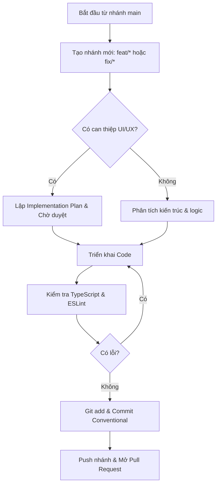

# 🚀 Quy Trình Phát Triển Tính Năng & Git Workflow (EchoChunk)

> **Vị trí:** `.agents/workflows/feature-workflow.md`  
> **Áp dụng cho:** Tất cả các thành viên và AI Assistant khi phát triển tính năng, sửa lỗi hoặc refactor trong dự án EchoChunk.

---

## 📌 Tổng Quan Quy Trình



---

## 🛠️ Chi Tiết Các Bước Thực Hiện

### Bước 1: Cập nhật `main` và Tạo nhánh mới

Trước khi bắt đầu bất kỳ công việc nào, luôn đảm bảo nhánh `main` ở trạng thái mới nhất:

```bash
# 1. Chuyển về main và kéo cập nhật mới nhất
git checkout main
git pull origin main

# 2. Tạo và chuyển sang nhánh làm việc mới
# Quy ước đặt tên: feat/<tên-tính-năng>, fix/<lỗi-cần-sửa>, refactor/<nội-dung>
git checkout -b feat/<ten-tinh-nang>
```

**Ví dụ:**
- `feat/youtube-study-suite`
- `feat/shadowing-karaoke`
- `fix/youtube-iframe-leak`

---

### Bước 2: Lập Kế Hoạch Trước Khi Viết Code (Planning Phase)

- **Nếu thay đổi Giao diện (Frontend / UI / UX):**
  - **Bắt buộc tuân thủ:** [`.agents/rules/frontend-planning-rule.md`](file:///d:/SelfLearning/EchoChunk/.agents/rules/frontend-planning-rule.md).
  - Trình bày chi tiết **Implementation Plan** (layout, components tác động, responsive, cam kết Zero Layout Shift).
  - Chờ người dùng xác nhận / phê duyệt trước khi can thiệp vào file `.tsx` hay `.css`.

- **Nếu làm việc với Backend / Logic / State:**
  - Xác định rõ dữ liệu (Types/Interfaces), Server Actions, Service functions.
  - Tuân thủ cấu trúc phân tầng: `src/server/services/` và `src/server/actions/`.

---

### Bước 3: Triển Khai Mã Nguồn (Implementation)

Tuân thủ các tiêu chuẩn kỹ thuật cốt lõi trong [`CLAUDE.md`](file:///d:/SelfLearning/EchoChunk/CLAUDE.md):

1. **React 19 Standards:**
   - Không gọi `setState` đồng bộ trong `useEffect` (tuân thủ rule `react-hooks/set-state-in-effect`).
   - Sử dụng `useSyncExternalStore` cho client state / hydration detection (ví dụ qua [`useIsClient.ts`](file:///d:/SelfLearning/EchoChunk/src/hooks/useIsClient.ts)).
   - Tối ưu `React.memo` cho các danh sách dòng phụ đề / chunks lặp lại.

2. **Styling & CSS:**
   - Sử dụng **Vanilla CSS** chuẩn Notion Clean Light (tập trung trong `src/app/globals.css`).
   - Đặt tiền tố rõ ràng cho từng module (ví dụ `.yt-*`).
   - Tuyệt đối không để xảy ra **Layout Shift** khi hover hoặc đổi trạng thái.

---

### Bước 4: Kiểm Thử Tĩnh & Linting (Mandatory Verification)

Trước khi commit, **BẮT BUỘC** chạy kiểm tra chất lượng mã nguồn:

```bash
# Kiểm tra Type Safety
pnpm tsc --noEmit

# Kiểm tra Linter
pnpm eslint <các_file_đã_sửa>
# hoặc kiểm tra toàn dự án:
pnpm eslint src/
```

> [!IMPORTANT]
> Chỉ được phép chuyển sang bước tiếp theo khi kết quả đạt **0 errors** và **0 warnings** nghiêm trọng.

---

### Bước 5: Kiểm Tra Trạng Thái Git (Review Changes)

Kiểm tra danh sách các file đã thay đổi để tránh commit nhầm file rác, file nháp:

```bash
git status
git diff --stat
```

---

### Bước 6: Commit Theo Chuẩn Conventional Commits

Thêm các file cần thiết và commit với thông điệp rõ ràng, đúng format:

```bash
git add <các_file_hoặc_thư_mục>
git commit -m "<type>(<scope>): <mô tả ngắn gọn bằng tiếng Anh hoặc tiếng Việt>"
```

**Các prefix chuẩn:**
- `feat`: Thêm tính năng mới (ví dụ: `feat(youtube): add karaoke word-level sync`)
- `fix`: Sửa lỗi (ví dụ: `fix(audio): resolve audio context memory leak`)
- `refactor`: Tái cấu trúc mã nguồn không làm đổi chức năng (ví dụ: `refactor(player): isolate youtube iframe controls`)
- `docs`: Cập nhật tài liệu, README, TODO (ví dụ: `docs: update roadmap for practice modes`)
- `style`: Định dạng CSS, khoảng trắng, giao diện Notion clean light

---

### Bước 7: Đẩy Nhánh Lên Remote & Tạo Pull Request (PR)

```bash
# Đẩy nhánh lên GitHub
git push -u origin <ten-nhanh>
```

- Mở Pull Request trên GitHub hướng vào nhánh `main`.
- Điền mô tả chi tiết:
  - Tóm tắt thay đổi.
  - Danh sách màn hình / component mới kèm ảnh chụp (nếu có).
  - Kết quả chạy `pnpm tsc` và `pnpm eslint`.
- Tiến hành Review và Merge (Squash merge hoặc Merge commit theo chính sách repo).
