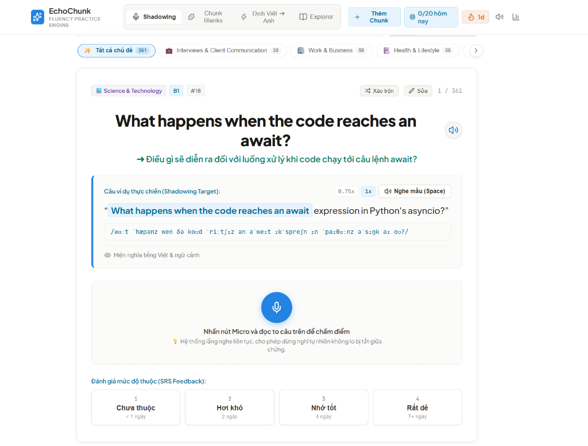

# EchoChunk - Contextual Speaking Chunks Fluency Engine 🎙️⚡

<p align="center">
  
</p>

<p align="center">
  <b>Ứng dụng web chuyên sâu luyện phản xạ nói tiếng Anh theo cụm (Speaking Chunks) & Luyện Shadowing qua YouTube với mốc thời gian từng từ.</b>
</p>

<p align="center">
  
  
  
  
  
  
</p>

---

## 💡 Tại sao là EchoChunk?

Hầu hết người học tiếng Anh đều gặp trở ngại khi chuyển từ việc **"hiểu ngữ pháp"** sang **"nói trôi chảy theo quán tính"**:
* **Flashcard rời rạc (Anki / Quizlet)**: Học từng từ đơn lẻ khiến não bộ tốn thời gian lắp ráp câu khi nói.
* **Ghi chú tĩnh (Notion)**: Thiếu môi trường tương tác âm thanh, không có phản hồi phát âm theo thời gian thực.

**EchoChunk** giải quyết bài toán trên bằng cách huấn luyện não bộ phản xạ theo **Cụm từ cố định (Speaking Chunks)** trong ngữ cảnh thực tế (Work, IT, Interview, Daily Life...) kết hợp cùng phòng luyện **YouTube Shadowing** với hiệu ứng Karaoke từng chữ.

---

## 🌟 5 Chế độ Luyện tập Đột phá

### 1. 🎬 YouTube Shadowing Studio *(Tính năng mới)*
* **Dán bất kỳ link YouTube nào**: Hỗ trợ đầy đủ các định dạng link (`watch?v=`, `youtu.be/`, `shorts/`, `embed/` hoặc Video ID).
* **Karaoke Word Highlighting theo thời gian thực**: Từng từ trong câu tự động sáng lên khớp với nhịp nói của video, hỗ trợ mắt và miệng bắt nhịp cùng lúc.
* **Click-to-Seek**: Bấm vào bất kỳ câu nào trong danh sách để video lập tức tua đến đúng mốc thời gian của câu đó để luyện shadowing lặp lại.
* **Cơ chế Fallback 2 tầng linh hoạt**:
  * *Tầng 1 (Native YouTube)*: Ưu tiên bóc tách XML `srv3` gốc để lấy chuẩn xác mốc thời gian từng từ.
  * *Tầng 2 (Provider Fallback)*: Tự động chuyển sang `ytranscript.com` API khi chạy trên môi trường Vercel hoặc bị YouTube chặn IP server, kết hợp thuật toán nội suy thời gian từ thông minh.
* **Global Cloud Firestore Cache**: Tự động lưu cache phụ đề lên Firestore ngay sau lần transcript đầu tiên. Các lần học sau (hoặc người dùng khác) sẽ tải lên tức thì (vài chục ms) và **tiết kiệm 100% chi phí API**.
* **Lưu lịch sử & Tiến độ học**: Ghi nhớ danh sách video gần đây và số câu đã hoàn thành theo từng tài khoản.

---

### 2. 🎙️ Shadowing & Pronunciation Lab
* **Phát âm chuẩn người bản xứ (Neural TTS)**: Sử dụng Microsoft Edge Neural TTS (`en-US-JennyNeural`, MP3 24kHz) kèm tùy chọn tốc độ (`1.0x` / `0.75x`), tự động cache và fallback về Web Speech Synthesis khi mất mạng.
* **Nhận diện giọng nói trực tiếp**: Nhấn giữ phím Micro để nhại lại câu.
* **So khớp phát âm theo thời gian thực (Color-coded Diff)**:
  * 🟢 **Xanh lá**: Phát âm chuẩn xác.
  * 🔴 **Đỏ**: Bị bỏ sót hoặc phát âm chưa rõ.
  * 🟡 **Vàng**: Từ chen ngang / nói thừa.
* **Chấm điểm Accuracy %** và hiệu ứng pháo hoa Confetti khi đạt kết quả xuất sắc.

---

### 3. 🧩 Chunk Blanks (Active Recall Cloze)
* Speaking Chunk quan trọng trong câu bị ẩn đi `[ ? ]`.
* Người học dựa vào ngữ cảnh và giải nghĩa tiếng Việt để tự gõ hoặc bấm Mic nói để nhớ lại chủ động.
* Nhấn **Enter** để kiểm tra đáp án, đối chiếu câu chuẩn và nghe audio mẫu.

---

### 4. ⚡ Reflex 5s Drill (Thử thách Phản xạ 5 Giây)
* Đưa ra các tình huống giao tiếp tiếng Anh công sở / IT thực chiến (báo lỗi deploy, thỏa thuận deadline, từ chối yêu cầu phát sinh...).
* Đồng hồ đếm ngược **5 giây** kèm âm thanh tích tắc tạo áp lực nhả chữ tức thì như giao tiếp thực tế.
* Bấm **Đã nói xong! Xem câu chuẩn** để kiểm tra phản xạ.

---

### 5. 📚 Topic Explorer & Custom Chunks
* Duyệt kho từ vựng chuẩn hóa: **12 chủ đề**, hơn **385 thẻ PrepTalk** được tuyển chọn kỹ lưỡng.
* **Custom Speaking Chunks**: Cho phép người dùng tự tạo cụm từ vựng riêng của mình và đồng bộ 2 chiều lên Cloud Firestore.

---

## 🔄 Hệ Thống Lưu Trữ & Đồng Bộ Đám Mây (Local-to-Cloud)

* **Hỗ trợ khách (Guest Mode)**: Người dùng chưa đăng nhập vẫn sử dụng đầy đủ mọi tính năng; dữ liệu được lưu cục bộ an toàn trong `localStorage`.
* **Xác thực Google (Firebase Auth)**: Đăng nhập 1-click tiện lợi và an toàn.
* **Cơ chế Local-to-Cloud Merge**: Khi người dùng đăng nhập lần đầu, toàn bộ tiến độ học, lịch sử và từ vựng tự tạo từ `localStorage` sẽ tự động hợp nhất lên Cloud Firestore mà không làm mất bất kỳ dữ liệu nào.

---

## 🛠️ Công Nghệ & Kiến Trúc

* **Framework**: [Next.js 16.3.4](https://nextjs.org/) (App Router, Turbopack, Server Actions)
* **Thư viện UI**: [React 19.2.8](https://react.dev/), [Lucide React](https://lucide.dev/), [Canvas Confetti](https://www.npmjs.com/package/canvas-confetti)
* **Styling**: [Tailwind CSS 3.4](https://tailwindcss.com/)
* **Backend & Database**: [Firebase v12](https://firebase.google.com/) (Auth, Cloud Firestore)
* **Speech & Audio Engine**:
  * **Neural TTS**: [msedge-tts](https://www.npmjs.com/package/msedge-tts) (Microsoft Edge Neural Voice `en-US-JennyNeural`, streaming MP3 24kHz Mono, LRU In-memory Cache & Vercel Edge CDN Caching).
  * **Speech Recognition**: Web Speech API (`webkitSpeechRecognition` & `SpeechRecognition`).
* **Phonetics & IPA Engine**: Hệ thống phiên âm General American offline **124,895 từ vựng** dựa trên [menelik3/cmudict-ipa](https://github.com/menelik3/cmudict-ipa) (CMUdict v0.7b), tra cứu tức thì $O(1)$ với 0ms độ trễ.
* **YouTube Service**: Tự chủ giải thuật trích xuất phụ đề `srv3` / `classic` XML + Fallback Provider REST API.

---

## 🚀 Hướng Dẫn Cài Đặt & Khởi Chạy

### 1. Yêu cầu môi trường
* **Node.js**: Phiên bản `18.18.0` trở lên (khuyên dùng Node 20+)
* **Package Manager**: `npm`, `pnpm`, hoặc `yarn`

### 2. Cài đặt mã nguồn

```bash
# Clone repository
git clone https://github.com/taiphanvan2k3/EchoChunk.git
cd EchoChunk

# Cài đặt các gói phụ thuộc
npm install
```

### 3. Cấu hình biến môi trường (`.env.local`)

Tạo file `.env.local` ở thư mục gốc của dự án (tham khảo mẫu tại `.env.example`):

```env
# Firebase Client SDK Credentials
NEXT_PUBLIC_FIREBASE_API_KEY=your_firebase_api_key
NEXT_PUBLIC_FIREBASE_AUTH_DOMAIN=your_project.firebaseapp.com
NEXT_PUBLIC_FIREBASE_PROJECT_ID=your_project_id
NEXT_PUBLIC_FIREBASE_STORAGE_BUCKET=your_project.firebasestorage.app
NEXT_PUBLIC_FIREBASE_MESSAGING_SENDER_ID=your_messaging_sender_id
NEXT_PUBLIC_FIREBASE_APP_ID=your_app_id
NEXT_PUBLIC_FIREBASE_MEASUREMENT_ID=your_measurement_id

# YouTube Transcript Fallback Provider (ytranscript.com)
YTRANSCRIPT_API_KEY=your_ytranscript_api_key
```

### 4. Khởi chạy Development Server

```bash
npm run dev
```

Truy cập ứng dụng tại: **`http://localhost:3000`**

> [!TIP]
> Để trải nghiệm tính năng thu âm nhận diện giọng nói (Speech Recognition) mượt mà nhất, hãy sử dụng **Google Chrome** hoặc **Microsoft Edge** và cấp quyền Microphone khi được hỏi.

---

## 🛡️ Cấu Hình Cloud Firestore Security Rules

Để cơ chế Cache phụ đề YouTube công khai và đồng bộ dữ liệu hoạt động chính xác, đảm bảo rules trên Firebase Console tương thích với file [firestore.rules](firestore.rules):

```rules
rules_version = '2';
service cloud.firestore {
  match /databases/{database}/documents {
    function isAuthenticated() {
      return request.auth != null;
    }
    function isOwner(userId) {
      return isAuthenticated() && request.auth.uid == userId;
    }

    // 1. Dữ liệu cá nhân: Chỉ chính chủ mới có quyền Đọc & Ghi
    match /users/{userId} {
      allow read, write: if isOwner(userId);
      match /{subcollection=**} {
        allow read, write: if isOwner(userId);
      }
    }

    // 2. Kho từ vựng Master Chunks hệ thống: Khách và User đều đọc được
    match /chunks/{chunkId} {
      allow read: if true;
      allow write: if false;
    }

    // 3. Decks cộng đồng
    match /decks/{deckId} {
      allow read: if true;
      allow create: if isAuthenticated() && request.resource.data.authorId == request.auth.uid;
      allow update, delete: if isAuthenticated() && resource.data.authorId == request.auth.uid;
    }

    // 4. Cache phụ đề YouTube công khai: ai cũng đọc được, cho phép tạo mới/cập nhật, cấm xóa
    match /youtube_transcripts/{videoId} {
      allow read: if true;
      allow create, update: if true;
      allow delete: if false;
    }
  }
}
```

Deploy rules nhanh bằng Firebase CLI:
```bash
npx firebase-tools deploy --only firestore:rules
```

---

## ⌨️ Phím Tắt Tiện Lợi (Keyboard Shortcuts)

| Phím | Chức năng | Chế độ áp dụng |
| :--- | :--- | :--- |
| **`Space`** | Phát / Dừng âm thanh câu ví dụ mẫu | Toàn bộ bài học |
| **`Enter`** | Nộp bài kiểm tra điền từ / Mở khóa đáp án | Chunk Blanks |
| **`Phím 1`** | Đánh giá SRS: **Chưa thuộc** (< 1 ngày) | Shadowing / Blanks |
| **`Phím 2`** | Đánh giá SRS: **Hơi khó** (2 ngày) | Shadowing / Blanks |
| **`Phím 3`** | Đánh giá SRS: **Nhớ tốt** (4 ngày) | Shadowing / Blanks |
| **`Phím 4`** | Đánh giá SRS: **Rất dễ** (7+ ngày) | Shadowing / Blanks |

---

## 📁 Cấu Trúc Thư Mục Dự Án (Project Structure)

```text
EchoChunk/
├── public/                     # Static assets, demo images
├── src/
│   ├── app/                    # Next.js App Router Pages & API Routes
│   │   ├── blanks/             # Trang Chunk Blanks
│   │   ├── explorer/           # Trang duyệt chủ đề
│   │   ├── reflex/             # Trang phản xạ 5s
│   │   ├── shadowing/          # Trang Shadowing Lab
│   │   ├── youtube/            # Trang YouTube Shadowing Studio
│   │   └── page.tsx            # Trang chủ Dashboard
│   ├── components/             # React UI Components
│   │   ├── common/             # Navbar, Footer, Modal, Cards...
│   │   └── youtube/            # YouTubePlayer, SentenceList, StudyRoom...
│   ├── context/                # React Contexts (AuthContext, PracticeContext...)
│   ├── data/                   # Master Chunks dataset (12 topics, 385 cards)
│   ├── hooks/                  # Custom Hooks (useSpeech, useIsClient...)
│   ├── lib/                    # Core Libraries & Services
│   │   ├── firebase/           # Firebase client init & Firestore operations
│   │   └── youtube-history.ts  # Local history manager for YouTube practice
│   ├── server/                 # Next.js Server Actions & Backend Services
│   │   ├── actions/            # youtube.actions.ts...
│   │   └── services/           # youtube.service.ts (InnerTube + Fallback + Cache)
│   └── types/                  # TypeScript Interface Definitions
├── firestore.rules             # Cloud Firestore Security Rules
├── next.config.ts              # Next.js Configuration
├── package.json
└── tailwind.config.ts          # Tailwind Styling Configuration
```

---

## 📄 License

Dự án được phát hành dưới giấy phép mã nguồn mở [MIT License](LICENSE).
Mọi đóng góp (Pull Requests / Issues) đều được chào đón nồng nhiệt!