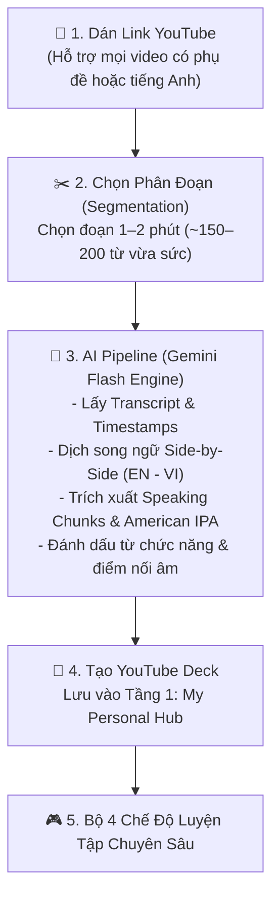
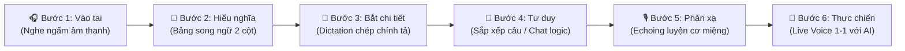

# 🎬 Tính Năng: Biến Video YouTube Thành Bài Học Tương Tác (YouTube-to-Interactive Study Suite)

> **Mục đích tài liệu:** Đặc tả thiết kế kỹ thuật, luồng người dùng (UX Flow) và các chế độ luyện tập của tính năng nhập link YouTube để tự động tạo bộ thẻ học tương tác trong **EchoChunk**.

---

## 🎯 1. Bối Cảnh & Triết Lý Sản Phẩm

### Vấn Đề Giải Quyết
- Người học thường chán nản với các đoạn audio nhân tạo hoặc chủ đề cố định trong sách giáo khoa vì thiếu tính liên kết cá nhân.
- Trong các nghiên cứu của AlexD, yếu tố kích hoạt tiềm thức mạnh nhất là **"SỐC" (Cảm xúc & Hứng thú cá nhân)**. Khi được học từ chính những nội dung người học yêu thích ngoài đời thực (Vlog nấu ăn, hướng dẫn pha cà phê, review công nghệ, podcast, TED Talks, phân tích bóng đá...), khả năng ghi nhớ từ vựng và cụm câu tăng gấp nhiều lần.
- Ngôn ngữ trong video YouTube là **ngôn ngữ sống (Real-life spoken English)**: có lướt âm, nuốt âm, nhịp thở và ngữ điệu tự nhiên.

---

## 🔄 2. Luồng Xử Lý Dữ Liệu (Processing Pipeline)



### Các Bước Chi Tiết:
1. **Bước 1 — Nhập URL:** Người dùng dán bất kỳ link YouTube nào vào ô tìm kiếm/nhập liệu.
2. **Bước 2 — Trích xuất & Chọn đoạn:**
   - Hệ thống tự động tải phụ đề kèm mốc thời gian (*Timestamps*).
   - Cho phép người dùng trượt thanh timeline để chọn một phân đoạn dài **1 đến 2 phút** (tương đương khoảng **150 – 200 từ**, đúng độ dài tối ưu theo khuyến nghị của AlexD).
3. **Bước 3 — Xử lý qua AI (Gemini Flash):**
   - Tạo bảng đối chiếu song ngữ: Tiếng Anh bản gốc và Tiếng Việt dịch thoát ý theo ngữ cảnh.
   - Bóc tách **3 đến 5 cụm Speaking Chunks** đắt giá nhất trong đoạn.
   - Tra cứu phiên âm General American IPA cho từ vựng quan trọng.
   - Ghi chú các hiện tượng nối âm (*connected speech*) và từ chức năng (*function words*).
4. **Bước 4 — Lưu trữ Deck:** Tạo một Deck mới thuộc loại `YOUTUBE_DECK` gắn với Video ID.

---

## 🧭 3. Lộ Trình 6 Bước Chuẩn Hóa (The 6-Step Guided Flow)

> **Mốc thời gian video gốc của AlexD:** Phút [17:42 (t=1062s)](https://youtu.be/-Z1ad2a_BCo?si=3RiuPnyCjVAHLTxe&t=1062) — *"Lộ trình học tiếng Anh · Người mới bắt đầu"*.

Thay vì để các tính năng rời rạc khiến người học bối rối, giao diện học từ Video trong EchoChunk được điều hướng bởi một **Thanh tiến trình 6 bước (Guided Stepper)**:



---

### 🎧 Bước 1: Vào tai (Focus Listening / Ear Intake)
- **Mục tiêu:** Tiếp nhận âm thanh thuần khiết, làm quen với nhịp điệu và ngữ điệu tự nhiên của người bản xứ mà không bị phân tâm bởi mặt chữ.
- **Trải nghiệm:** Video chạy ở chế độ Focus (có thể chọn tốc độ `0.75x` hoặc `1.0x`), ẩn phụ đề hoặc chỉ hiện hình ảnh để người học tập trung hoàn toàn vào thính giác.

---

### 📖 Bước 2: Hiểu nghĩa (Bilingual Sync Matrix & Word Inspector)
- **Mục tiêu:** Khớp nối ý niệm, nạp ngữ cảnh vào tầng ý thức mà không cần tra từ điển rời.
- **Prompt Mẫu Chuẩn Từ AlexD:**
  > *"Hãy làm cho tôi cái bảng 2 bên side by side một bên tiếng Anh, một bên tiếng Việt. Và in đậm các từ mới, nhớ là chỉ in đậm các từ mới, các từ khó trong bài thôi nhé, để tôi có thể nhìn ra và hiểu."*
- **Cấu Trúc Bảng Song Ngữ Trực Quan:**

| 🇬🇧 English | 🇻🇳 Tiếng Việt |
| :--- | :--- |
| Today I want to talk about drinking tea. | Hôm nay tôi muốn nói về việc uống trà. |
| I really like tea because it makes me feel **calm** and happy. | Tôi rất thích trà vì nó khiến tôi cảm thấy **bình tĩnh** và vui vẻ. |
| I usually drink green tea or fruit tea. | Tôi thường uống trà xanh hoặc trà trái cây. |

- **Nâng cấp tương tác của EchoChunk:**
  - **In đậm đối xứng:** Cặp từ/chunk quan trọng (`calm` ➔ `bình tĩnh`) đối xứng ở 2 cột.
  - **Word Inspector Bar:** Bấm vào từ để soi phiên âm chuẩn **General American IPA 🇺🇸** (`/kɑːm/`) và nghe phát âm chậm `0.7x`.
  - **Đồng bộ Video 1-Chạm (`seekTo`):** Bấm dòng nào, video tự nhảy đến đúng giây đó.

---

### 📝 Bước 3: Bắt chi tiết (Dictation Lab / Close Listening)
- **Mục tiêu:** Bắt các từ chức năng (*in, on, at, the*) và hiện tượng nối âm / nuốt âm (*goes off, a flat white*) mà tai người Việt thường bỏ qua.
- **Trải nghiệm:**
  - Video phát từng câu ngắn (3–5 giây) rồi **tự động tạm dừng (Auto-Pause)**.
  - Hệ thống đục lỗ che đi các từ chức năng hoặc từ in đậm.
  - Người học nghe và gõ từ còn thiếu ➔ `Enter` để kiểm tra. Nếu sai, hệ thống tua lại 3 giây, phát ở tốc độ chậm `0.75x` và giải thích hiện tượng nuốt âm.

---

### 💬 Bước 4: Tư duy (Cognitive Framing & Sentence Reorder)
- **Mục tiêu:** Não tập ghép câu và phản xạ ngữ nghĩa trước khi phải vận động cơ miệng, giải tỏa áp lực tâm lý cho người hướng nội.
- **Trải nghiệm:**
  - **Bài tập Sắp xếp câu (Sentence Reorder):** Rèn luyện từ dẫn đường (*Signpost Words: First, Then, Next, After that, Finally*).
  - **Chat Logic với AI (Text):** Người học gõ phím trả lời các câu hỏi gợi mở của AI về nội dung video.

---

### 🎙️ Bước 5: Phản xạ (Echoing Lab & Speech Production)
- **Mục tiêu:** Rèn luyện cơ miệng và nhịp điệu dội âm (Echoing) có khoảng lặng, không ép nói đè.
- **Trải nghiệm:**
  - Video phát xong một câu ➔ Dừng lại tạo **khoảng lặng 2–3 giây** (để não ghi nhớ âm vang trong *Echoic Memory*).
  - Người học bấm Mic nói lại câu vừa nghe.
  - Thuật toán Web Speech Recognition so khớp thời gian thực:
    - 🟢 **Xanh:** Phát âm chuẩn xác.
    - 🔴 **Đỏ:** Bị nuốt âm đuôi (`grounds` thiếu `/z/`, `place` nhầm thành `play`) hoặc phát âm sai.

---

### 📡 Bước 6: Thực chiến (AI Live Voice & Roleplay)
- **Mục tiêu:** Đạt tới độ phản xạ giao tiếp tự nhiên 2 chiều trong đời sống.
- **Trải nghiệm:**
  - AI đóng vai nhân vật hoặc đối tác đàm thoại trực tiếp bằng giọng nói (Voice Agent).
  - Đặt câu hỏi mở về chủ đề video để người học phản xạ đối đáp thời gian thực không sợ phán xét.

---

## 🏗️ 4. Thiết Kế Cấu Trúc Dữ Liệu (Data Schema)

```typescript
export interface YouTubeDeckMeta {
  deckId: string;
  type: 'YOUTUBE_DECK';
  videoId: string;
  videoTitle: string;
  thumbnailUrl: string;
  channelName: string;
  durationSeconds: number;
  selectedSegment: {
    startSeconds: number;
    endSeconds: number;
  };
  totalChunks: number;
  createdAt: string;
}

export interface YouTubeSubtitleLine {
  id: string;
  start: number; // Thời điểm bắt đầu (giây)
  duration: number; // Thời lượng câu (giây)
  text: string; // Câu tiếng Anh
  translation: string; // Bản dịch tiếng Việt
  chunks: string[]; // Các speaking chunks có trong câu
  missingWordsForDictation: string[]; // Các từ bị ẩn trong chế độ Dictation
}
```

---

## 🛠️ 5. Thư Viện & Công Nghệ Dự Kiến Sử Dụng

- **Video Player:** `react-youtube` hoặc YouTube IFrame Player API.
- **Trích xuất Subtitle:** Thư viện `youtube-transcript` hoặc route backend gọi Gemini Flash phân tích audio/video.
- **Âm thanh & Phát âm:** Web Speech Recognition + Web Speech Synthesis (đã có sẵn trong EchoChunk).
- **Từ điển IPA:** `src/lib/ipa.ts` và từ điển offline `src/data/american-ipa.json` (25,681 từ).
