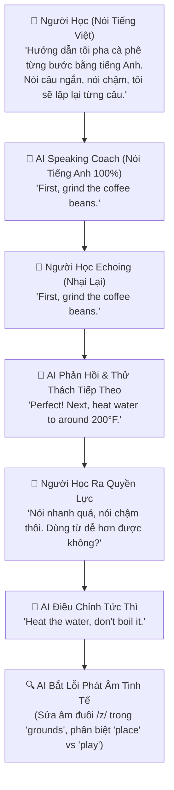

# 🗣️ Nghiên Cứu Phương Pháp "Echoing vs. Shadowing" (AlexD) & Ứng Dụng Tiềm Thức Trong EchoChunk

> **Tài liệu tham chiếu:** Đúc kết từ video phân tích phương pháp luyện nói tiếng Anh bằng **Echoing** và **Tiềm thức** của AlexD, đối chiếu với triết lý thiết kế và tên gọi của dự án **EchoChunk**.

---

## 🧠 PHẦN 1: GIỚI HẠN CỦA SHADOWING & ĐỘT PHÁ TỪ ECHOING

### 1. Điểm Tới Hạn của Shadowing Truyền Thống (The Shadowing Plateau)
- **Bản chất Shadowing:** Bật audio người bản xứ chạy liên tục ở tốc độ bình thường và người học cố gắng "nói đè" (nói cùng một lúc) theo ngữ điệu.
- **Vấn đề cốt tử:** Sau một giai đoạn luyện tập, hầu hết người học đều chạm trần (plateau):
  - **Chỉ nhớ được ~10% thông tin:** Shadowing ép não bộ xử lý ở tầng **ý thức** (phần nổi của tảng băng chìm). Người học mải miết đuổi theo âm thanh như một con vẹt mà không kịp cảm nhận ngữ nghĩa, cảm xúc hay cấu trúc.
  - **Thiếu tính chủ động:** Bắt chước 100% tài liệu người khác giao cho, không có sự gắn kết cá nhân.
  - **Nguy cơ nuốt âm và sợ hãi:** Tốc độ nhanh khiến cơ miệng người mới bị quá tải, dễ nói lướt, nuốt các âm đuôi quan trọng (`/s/`, `/z/`, `/t/`, `/d/`).

---

### 2. Kỹ Thuật "Echoing" (Dội Âm Có Khoảng Lặng)
- **Định nghĩa:** Echoing là kỹ thuật cho phép có **khoảng dừng (pause)** giữa âm thanh gốc và lượt nói của người học:
  $$\text{Audio mẫu phát câu ngắn} \longrightarrow \text{Khoảng lặng (Lưu vào Echoic Memory)} \longrightarrow \text{Miệng dội âm lại (Echo back)}$$
- **Hình tượng so sánh:** Giống như **cha mẹ kiên nhẫn dạy con tập nói**:
  - Nói từng câu ngắn, từ tốn.
  - Chờ đợi đứa trẻ lắng nghe trọn vẹn, định hình âm thanh trong đầu rồi mới lặp lại.
  - Chỉnh sửa nhẹ nhàng từng âm cho tới khi chuẩn xác nhất rồi mới đi tiếp câu sau.
- **Giá trị cốt lõi:** Kỹ thuật này giải phóng áp lực tâm lý, đặc biệt phù hợp cho **người hướng nội (introverts)** hoặc người mới bắt đầu luyện cơ miệng.

---

## 🌊 PHẦN 2: CƠ CHẾ TIỀM THỨC (90%) VÀ CÔNG THỨC "SỐC + LẶP"

### 1. Ý Thức (10%) vs. Tiềm Thức (90%)
- Hầu hết các kỹ năng thuần thục trong đời sống đều do **tiềm thức** vận hành:
  - *Đánh răng:* Tay đưa lên xuống vô thức, không ai phải nghĩ "cơ cổ tay đang co bóp thế nào".
  - *Gõ máy tính:* 10 ngón tay tự gõ phím không cần nhìn từng chữ cái.
  - *Nói tiếng mẹ đẻ:* Nói ra tự nhiên, không bao giờ phải nghĩ xem đây là thì quá khứ hay tương lai, chia động từ thế nào.
- Học tiếng Anh truyền thống thất bại vì cố gắng nhồi nhét quy tắc ngữ pháp (ý thức) thay vì biến thành phản xạ cơ bắp và cảm giác ngôn ngữ (tiềm thức).

---

### 2. Hai Con Đường Đưa Ngôn Ngữ Vào Tiềm Thức: SỐC + LẶP
- **LẶP (Repetition):** Spaced Repetition (SRS) — Lặp lại ngắt quãng để xây dựng đường mòn thần kinh.
- **SỐC (Emotion & Personal Connection):**
  - Shadowing truyền thống chỉ có "Lặp" mà thiếu "Sốc" nên nhanh chán và dễ quên.
  - "Sốc" tạo ra khi:
    - Chủ đề gắn liền với **sở thích và nhu cầu thật** của chính người học (ví dụ: người mê cà phê học về pha chế).
    - Có **hình ảnh / video / trải nghiệm trực quan** (Visual Context).
    - Có **tương tác giao tiếp 2 chiều** (Interactivity) thay vì đọc một chiều.

---

## 🤖 PHẦN 3: KỸ THUẬT "AI SPEAKING COACH KIÊN NHẪN"

AlexD đề xuất một mô hình luyện nói 1-1 với Voice AI (Gemini) cực kỳ thực chiến:

### Các Đặc Điểm Đột Phá Của AI Speaking Coach:
1. **Giao tiếp song ngữ tự nhiên:** Người học dùng tiếng Việt để điều khiển luồng, yêu cầu đổi chủ đề hoặc tinh chỉnh; AI đáp lại 100% tiếng Anh tự nhiên.
2. **Kiên nhẫn tuyệt đối (Zero Judgment):** Có thể lặp lại 100 lần một câu mà không khó chịu — Liều thuốc giải tỏa nỗi sợ phán xét cho người hướng nội.
3. **Quyền lực thuộc về người học:** Dễ dàng ra lệnh *"Nói chậm hơn"*, *"Rút ngắn câu"*, *"Dùng từ đơn giản hơn"*.
4. **Sửa lỗi phát âm micro (Micro-Pronunciation Feedback):** Bắt chính xác các lỗi nuốt âm đuôi (`ground` vs `grounds`), biến âm, nối âm.

---

## 🧩 PHẦN 4: SIGNPOST WORDS (TỪ DẪN ĐƯỜNG) TRONG QUY TRÌNH THỰC CHIẾN

Thay vì học ngữ pháp chia thì khô khan, phương pháp tập trung vào **Signpost Words (Từ dẫn đường / Discourse Markers)** để diễn đạt chuỗi hành động logic:
- `First / First of all...` (Đầu tiên...)
- `Then...` (Sau đó...)
- `Next / Next up...` (Tiếp theo...)
- `After that...` (Sau bước đó...)
- `Finally / In the end...` (Cuối cùng...)

Bài tập xáo trộn thứ tự câu (Scramble & Reorder) kích thích tư duy sắp xếp của người học trước khi mở miệng nói, giúp cấu trúc câu ngấm sâu vào tiềm thức.

---

## 🎯 PHẦN 5: ÁNH XẠ VÀO KIẾN TRÚC DỰ ÁN ECHOCHUNK

### 1. Tại Sao Dự Án Tên Là `EchoChunk`?
- **Echo (Dội âm):** Người học nghe khối ngôn ngữ ➔ ngẫm nghĩ trong khoảng lặng ➔ dội âm lại (Echo back).
- **Chunk (Khối ngữ nghĩa):** Không học từ vựng đơn lẻ, luôn học theo cụm từ gắn liền với tình huống.
👉 *EchoChunk sinh ra chính là để hiện thực hóa phương pháp Echoing này!*

---

### 2. Các Ý Tưởng Nâng Cấp Sản Phẩm (Feature Ideas Backlog)

1. **Chuẩn hóa chế độ "Echoing & Pronunciation Lab":**
   - Giữ vững cơ chế: Nghe audio mẫu ➔ Có khoảng lặng ➔ Bấm Mic dội âm lại ➔ So khớp từ thời gian thực.
   - Word Inspector Bar chú trọng hiển thị rõ các **Ending Sounds** (`/s/`, `/z/`, `/ed/`, `/t/`) qua từ điển General American IPA offline.
2. **Bộ Preset "Quy Trình & Hướng Dẫn" (Step-by-Step Chunks):**
   - Thêm các bộ quy trình: *Cách pha cà phê*, *Cách cài đặt phần mềm / setup dự án*, *Cách chỉ đường*, *Cách giải quyết ticket hỗ trợ*.
   - Rèn luyện phản xạ với các từ dẫn đường (*First, Then, Next, After that, Finally*).
3. **Chế độ "AI Patient Coach" (Luyện Thoại 1-1 Không Phán Xét):**
   - Tích hợp Voice Agent sử dụng Gemini API với system prompt đóng vai người thầy kiên nhẫn, hỗ trợ người học hướng nội luyện nói từng bước.
