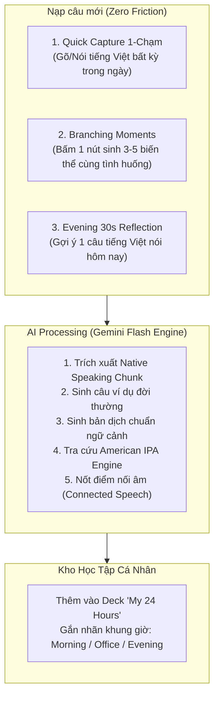
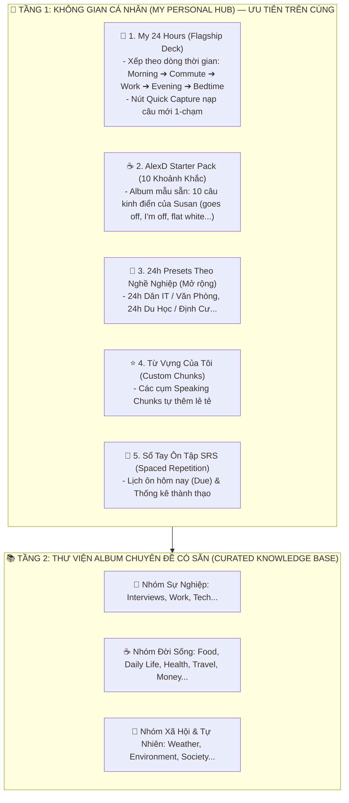

# 📑 Nghiên Cứu Phương Pháp "My 24 Hours" (AlexD) & Đặc Tả Flow Ứng Dụng EchoChunk

> **Tài liệu tham chiếu:** Đúc kết từ video phân tích phương pháp học tiếng Anh thực chiến của AlexD ([Xem trên YouTube: https://youtu.be/-Z1ad2a_BCo](https://youtu.be/-Z1ad2a_BCo?si=3kLAvVcD_v2HXXzK)) kết hợp với triết lý kiến trúc của dự án **EchoChunk**.

---

## 🧠 PHẦN 1: TỔNG HỢP PHƯƠNG PHÁP LUẬN CỦA ALEXD

### 1. Triết lý Cốt Lõi: "Giáo Trình Tốt Nhất Nằm Trong Một Ngày Của Bạn"
- **Dữ liệu thực tế:** Một người bình thường nói từ 12.000 – 16.000 từ mỗi ngày (~1.000 đến 2.000 câu).
- **Quy luật lặp lại:** 80% – 90% các câu nói trong ngày là lặp đi lặp lại y hệt từ ngày này qua ngày khác (*"Ăn cơm chưa?", "Mai mấy giờ họp?", "Cho ly cà phê sữa đá", "Tí nữa anh về"*). Con người nói những câu này hoàn toàn theo phản xạ vô thức, không cần suy nghĩ một giây nào.
- **Nghịch lý giáo trình truyền thống:** Các khóa học bắt đầu bằng *"Hello, what's your name? Where are you from?"*, nhưng trong thực tế người đi làm/sinh viên rất hiếm khi gặp người lạ để hỏi quê quán. Trong khi đó, bộ câu nói phục vụ chính cuộc sống hàng ngày thì không được dạy.

---

### 2. Bộ 3 Bài Test Khám Phá Lỗ Hổng Ngôn Ngữ
1. **Test 1 — Viết 10 tình huống trong ngày bằng tiếng Việt:**
   - 10 khoảnh khắc kinh điển:
     1. Vừa mở mắt, chuông reo (*6:30*).
     2. Bước ra khỏi nhà, chào người nhà (*7:45*).
     3. Đi mua cà phê / đồ ăn sáng (*8:15*).
     4. Gặp đồng nghiệp đầu tiên trong ngày (*8:45*).
     5. Trong cuộc họp nghe không rõ (*10:00*).
     6. Ai đó nhờ việc mà chưa làm ngay được (*11:00*).
     7. Đến giờ ăn trưa, rủ/hỏi người bên cạnh (*12:00*).
     8. Chiều gọi điện / nhắn tin về nhà (*17:30*).
     9. Mua đồ ăn tối / tạp hóa hỏi giá (*18:30*).
     10. Trước khi đi ngủ chào nhau / hẹn giờ (*22:30*).
   - *Kết luận:* Não bộ đã có sẵn 100% ngữ cảnh và kiến thức này bằng tiếng mẹ đẻ.

2. **Test 2 — Thử nói to 10 tình huống đó bằng tiếng Anh:**
   - Phát hiện rào cản: Hầu hết mọi người chỉ nói được 1–2 câu, bị khựng vì thiếu từ vựng chuyên ngành đời sống hoặc chưa biết ghép câu.

3. **Test 3 — Nghe chép chính tả (Transcribe / Dictation):**
   - Cho nghe đoạn audio người bản xứ (nhân vật mẫu Susan) nói về 10 khoảnh khắc đó.
   - *Insight cốt lõi:* **"Không nói được phần lớn vì chúng ta KHÔNG NGHE ĐƯỢC"**.
   - Người học không bắt được các **từ chức năng (Function words)**, **hiện tượng nối âm (Connected speech)**, **giảm âm / nuốt âm (Reductions)**:
     - *goes off* -> `/ɡoʊz ɑːf/`
     - *I'm off* -> Đi đây / đi làm đây
     - *how was your...* -> `/haʊ wəz jɔːr/`
     - *a flat white please*

---

### 3. Tâm Lý Học Hành Vi & Khoa Học Tạo Thói Quen (Atomic Habits)
- **Nghiên cứu về 3 nhóm rèn luyện thói quen (British Journal of Health Psychology):**
  - Nhóm 1 (Tự do, không tác động): **38%** hoàn thành.
  - Nhóm 2 (Được truyền cảm hứng / Động lực): **35%** hoàn thành (Động lực đơn thuần gần như không có tác dụng, thậm chí gây ảo tưởng).
  - Nhóm 3 (Có kế hoạch cụ thể: Giờ nào, Ngày nào, Ở đâu, Làm gì - *Implementation Intentions*): **91%** hoàn thành.
- **Hiện tượng Decision Fatigue (Suy kiệt quyết định):**
  - Mỗi ngày não bộ đưa ra hàng chục ngàn quyết định vô thức và 20–40 quyết định có ý thức.
  - Đến chiều tối, não kiệt sức, không còn khả năng tự quyết định "hôm nay học bài gì".
  - 👉 **Giải pháp:** Học **5 phút vào buổi sáng** ngay khi thức dậy, khi chưa mở mạng xã hội, chưa đọc email.
- **Quy tắc "Never Miss Twice" (Không bao giờ bỏ lỡ 2 ngày liên tiếp):**
  - Bỏ 1 ngày vì việc bận: Không sao cả.
  - Bỏ sang ngày thứ 2: Thói quen bị phá vỡ hoàn toàn.
- **Cột mốc định lượng:**
  - **50 câu:** Sống sót và giao tiếp cơ bản (Survival).
  - **500 câu:** Tự tin, thoải mái phản xạ tự nhiên (Fluency Freedom).

---

### 4. Lộ Trình 6 Bước Cho Người Mới Bắt Đầu (AlexD Roadmap)
- **Mốc thời gian trong video:** Phút [17:42 (t=1062s)](https://youtu.be/-Z1ad2a_BCo?si=3RiuPnyCjVAHLTxe&t=1062) — *"Lộ trình học tiếng Anh · Người mới bắt đầu"*.
- **Sơ đồ 6 bước chuyển hóa ngôn ngữ:**
  1. **Bước 1: Vào tai (🎧)** — Phải ngấm trước, nghe cho quen tai trước, không áp lực chữ viết.
  2. **Bước 2: Hiểu nghĩa (📖)** — Tìm hiểu từ vựng, mở lời thoại song ngữ Side-by-Side tra những chỗ chưa biết.
  3. **Bước 3: Bắt chi tiết (📝)** — Nghe chép chính tả (Dictation), bắt các từ chức năng và nối âm/nuốt âm.
  4. **Bước 4: Tư duy (💬)** — Luyện tư duy logic qua sắp xếp câu / chat text với AI trước khi nói.
  5. **Bước 5: Phản xạ (🎙️)** — Bật voice call luyện nói (Echoing nhại lại từng câu có khoảng lặng, kiểm tra phát âm).
  6. **Bước 6: Thực chiến (📡)** — Hội thoại tương tác 2 chiều, mở rộng chủ đề podcast dài.

---

## 🧩 PHẦN 2: ĐỐI CHIẾU & KẾ THỪA VÀO ECHOCHUNK

### Bảng Ánh Xạ Tính Năng (Feature Mapping)

| Triết lý của AlexD | Hiện trạng EchoChunk | Giải pháp tích hợp mới vào EchoChunk |
| :--- | :--- | :--- |
| **Gắn liền với 1 ngày cá nhân** | Đang có các Deck tĩnh theo chủ đề (Office, Casual, Interview...) | Thêm chế độ **"My 24 Hours" Deck** (Bộ câu theo trục thời gian 1 ngày). |
| **Thử phản xạ nói tiếng Anh (Test 2)** | Đã có chế độ **Quick Reflex Translation** (5s / 10s / Zen) | Tận dụng 100% Quick Reflex cho bộ câu "My 24 Hours". |
| **Nghe chép chính tả (Test 3)** | Đang có *Shadowing* (nói theo) và *Chunk Blanks* (điền từ theo nghĩa) | Bổ sung chế độ mới: **Dictation Lab (Nghe chép từ/cụm còn thiếu qua audio)**. |
| **5 phút buổi sáng tránh Decision Fatigue** | User phải tự chọn topic và mode luyện | Thêm nút **"5-Minute Morning Quick Start"**: Bấm 1 chạm vào học ngay 5–10 câu SRS Due. |
| **Cột mốc 50 ➔ 500 câu** | Có hệ thống điểm SRS và số chunk đã thành thạo | Thêm **Milestone Progress Bar** trực quan: `Level 1: 50 Chunks` ➔ `Level 2: 500 Chunks`. |
| **Quy tắc Never Miss Twice** | Đang lưu `streakDays` | Thêm **Streak Saver Banner**: Cảnh báo màu hổ phách khẩn cấp nếu ngày hôm qua bị lỡ học. |

---

## 🚀 PHẦN 3: GIẢI QUYẾT BÀI TOÁN "PHÁT SINH CÂU MỚI MỖI NGÀY"

Để tránh việc nội dung bị cạn kiệt hoặc người học lười nhập dữ liệu, hệ thống áp dụng **3 cơ chế nạp câu thông minh**:

### 1. Cơ Chế "Quick Capture" (Hộp Bắt Câu 1 Chạm)
- **Hành vi người dùng:** Trong ngày, người dùng chợt nghĩ ra một câu tiếng Việt muốn nói (ví dụ: *"Kẹt xe quá tí nữa tới trễ nha"* hoặc *"Cái này hạn sử dụng đến khi nào?"*).
- **Thao tác:** Bật EchoChunk, bấm nút Quick Capture, gõ hoặc bấm Mic nói câu tiếng Việt.
- **AI Engine tự động sinh đầy đủ:**
  - `chunk`: `running a bit late`
  - `meaning`: sắp trễ một chút
  - `exampleSentence`: `I'm stuck in traffic, so I'll be running about 15 minutes late.`
  - `translation`: Em bị kẹt xe nên chắc sẽ đến trễ khoảng 15 phút.
  - `ipa`: Tự sinh qua từ điển `american-ipa.json` offline.
  - `connectedSpeechNote`: Nối âm giữa `stuck in` -> `/stʌkɪn/`, giảm âm `about`.

### 2. Cơ Chế "Branching Moments" (Cây Biến Thể Tình Huống)
- Từ 1 khoảnh khắc gốc (ví dụ: *Mua cà phê sáng*), cho phép người dùng bấm **`[✨ Sinh biến thể tình huống]`** để AI mở rộng thêm 3–5 nhánh thực tế:
  - Khi mang đi: *"Can I get that to go, please?"*
  - Khi thanh toán: *"Do you take Apple Pay / bank transfer?"*
  - Tùy chỉnh: *"Could you make it less sweet with extra ice?"*
  - Hỏi gợi ý: *"What's your most popular drink here?"*

### 3. Cơ Chế "Evening 30s Reflection" (Gợi Ý Cuối Ngày)
- Vào lúc **21:30**, EchoChunk gửi nhắc nhở nhẹ:
  > *"Hôm nay có câu nào bạn nói bằng tiếng Việt mà ước gì lúc đó mình nói được bằng tiếng Anh không?"*
- Người dùng chỉ cần nhập 1 câu ➔ AI biến thành bài tập cho sáng hôm sau.

---

## 🏛️ PHẦN 4: KIẾN TRÚC THÔNG TIN & PHÂN LOẠI DANH MỤC (CATEGORY ARCHITECTURE)

> **Quyết định thiết kế (Approved Design):** Áp dụng **Phương án 1 — Phân tầng 2 Khối Độc Lập**. Tuyệt đối không xếp `My 24 Hours` lẫn vào 12 chủ đề tĩnh truyền thống để bảo toàn định vị Flagship Feature.

### Chi Tiết Phân Vai Các Danh Mục
1. **Tầng 1 (My Personal Hub):** Đóng vai trò là **"Phòng tập cá nhân"** — Nơi người dùng thực sự sống cùng tiếng Anh mỗi ngày, mở app vào sáng sớm là thấy ngay, không phải suy nghĩ lựa chọn (tránh *Decision Fatigue*).
2. **Tầng 2 (Curated Library):** Đóng vai trò là **"Kho bách khoa từ điển"** — Nơi người học tra cứu, mở rộng vốn từ theo các chủ đề chuyên biệt khi có nhu cầu cụ thể (phỏng vấn, đi du lịch, chuẩn bị bài thuyết trình).

---

## 🛠️ PHẦN 5: LỘ TRÌNH KỸ THUẬT TRIỂN KHAI (ROADMAP)

> **Trạng thái:** 💡 *Đang trong giai đoạn hoàn thiện ý tưởng & thiết kế kiến trúc (Brainstorming & Architecture Design). Chưa triển khai code.*

### Giai đoạn 1: Khởi tạo dữ liệu & Trải nghiệm cốt lõi
- [ ] Tạo Deck mẫu **"My 24 Hours (10 Khoảnh Khắc Hàng Ngày)"** chứa 10 tình huống của AlexD vào `src/data/speaking-chunks.json`.
- [ ] Gắn nhãn các khung giờ: `6:30 Morning`, `8:15 Commute`, `10:00 Office`, `12:00 Lunch`, `18:00 Evening`, `22:30 Bedtime`.
- [ ] Tái cấu trúc giao diện `TopicExplorerMode.tsx` hiển thị Khối "My Personal Hub" ở trên cùng.

### Giai đoạn 2: Bổ sung chế độ "Dictation Lab" (Nghe Chép Chính Tả)
- [ ] Tạo component `DictationMode.tsx`.
- [ ] Phát audio câu mẫu (1.0x và 0.75x chậm).
- [ ] Ẩn các **Function Words** và các cụm **Connected Speech**.
- [ ] Người dùng gõ từ nghe được ➔ Kiểm tra và giải thích hiện tượng nuốt âm/nối âm.

### Giai đoạn 3: AI Quick Capture & Scenario Generator
- [ ] Xây dựng API route `/api/generate-chunk` sử dụng Gemini API.
- [ ] Tạo Quick Capture Modal (nhập tiếng Việt ➔ tự sinh Speaking Chunk hoàn chỉnh).
- [ ] Nút "Sinh biến thể tình huống" (Branching Moments) cho từng chunk.

### Giai đoạn 4: Atomic Habit Dashboard (5-Min Morning & Milestone 50/500)
- [ ] Nút **"5-Minute Morning Quick Start"** trên Navbar.
- [ ] Cảnh báo **"Never Miss Twice"** khi phát hiện nghỉ học 1 ngày.
- [ ] Thanh tiến độ **Road to 500 Chunks** hiển thị ở trang chủ.

