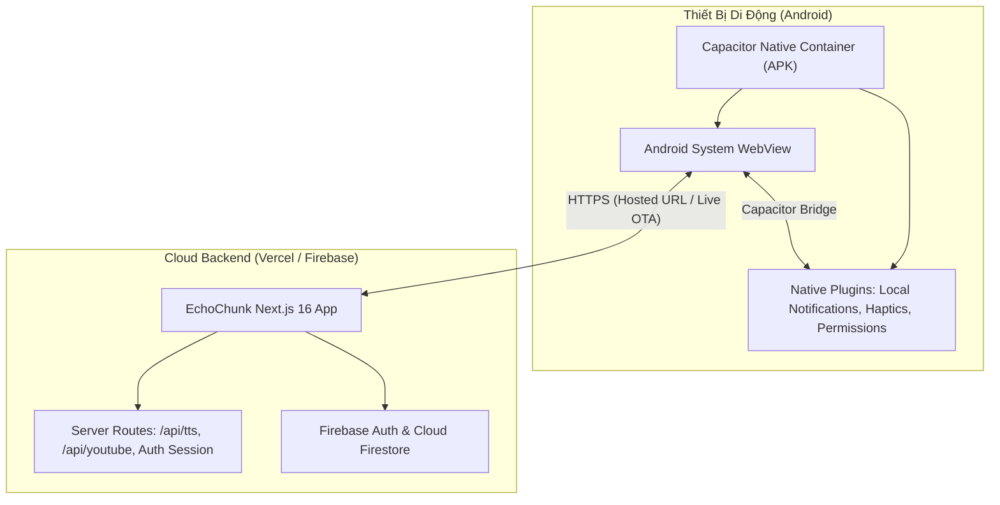

# Kế Hoạch Triển Khai Kỹ Thuật: Tích Hợp Capacitor Đóng Gói Mobile App (Android)

> **Tài liệu tham chiếu:** [docs/specs/05-capacitor-mobile-app/spec.md](spec.md) (`SPEC-05`)  
> **Phiên bản:** 1.0  
> **Trạng thái:** Sẵn sàng triển khai (Ready for Implementation)  
> **Nền tảng mục tiêu:** Android (Giai đoạn 1) ➔ iOS (Giai đoạn 2)

---

## 1. Mục Tiêu & Bối Cảnh (Goal Description)

EchoChunk hiện là ứng dụng web Next.js 16 (React 19) với đầy đủ các tính năng:
- **Shadowing Lab & Quick Reflex:** Luyện nói theo cụm kết hợp Microsoft Edge Neural TTS và Web Speech API.
- **SRS & Daily Streak:** Thuật toán lặp lại ngắt quãng (Spaced Repetition) và chuỗi học tập hàng ngày.
- **YouTube Study Room:** Học tiếng Anh qua video và phụ đề song ngữ thời gian thực.
- **Server Dependencies:** Sử dụng Server Route Handlers (`/api/tts`, `/api/auth/session`, `/api/youtube/*`) và SSR Cookie session verification (`src/app/layout.tsx`).

### Lý Do Chọn Kiến Trúc Capacitor Hosted Webview Shell (Theo SPEC-05)
1. **Tận dụng 100% mã nguồn Next.js 16 hiện có:** Không cần viết lại giao diện bằng React Native / Flutter.
2. **Bảo toàn các API Route Server:** Route `/api/tts` (sử dụng WebSocket tới Microsoft Edge TTS engine) và các tác vụ server-side chạy mượt mà không cần tách microservice.
3. **Cấp quyền Native Micro vĩnh viễn (`RECORD_AUDIO`):** Giải quyết dứt điểm lỗi trình duyệt mobile thu hồi micro hoặc ngắt luồng nhận diện giọng nói khi chuyển tab/tắt màn hình.
4. **Hệ thống nhắc nhở Native (Local Notifications):** Lập lịch chuông báo thức chính xác 7:00 AM (buổi sáng) và 20:00 PM (buổi tối) bằng `AlarmManager` của Android ngay cả khi đóng app hoàn toàn.
5. **Cập nhật tức thì (Over-The-Air OTA):** Các bản vá lỗi giao diện deploy lên Vercel sẽ tự động phản ánh ngay trên điện thoại của người dùng mà không cần build lại file APK.



---

## 2. Phân Tích Kiến Trúc: Hosted URL vs Static Export

| Tiêu chí so sánh | Lựa chọn 1: Hosted URL Shell (Khuyến nghị) | Lựa chọn 2: Static Export (`output: 'export'`) |
| :--- | :--- | :--- |
| **Server Components & SSR** | Giữ nguyên 100% (chạy trên Vercel) | Phải xóa bỏ toàn bộ `cookies()`, SSR trong `layout.tsx` |
| **API Routes (`/api/tts`, etc.)** | Hoạt động bình thường | Không chạy được nội bộ, phải tách sang server riêng |
| **Tốc độ triển khai** | Nhanh (~vài giờ) | Tốn nhiều ngày để refactor kiến trúc |
| **Cập nhật tính năng (OTA)** | Tức thì khi commit lên Vercel | Phải build lại APK và cài đặt lại |
| **Trải nghiệm Offline** | Cần mạng tải shell; Firestore cache dữ liệu học | Toàn bộ tài nguyên web tĩnh nằm sẵn trong APK |

> **Quyết định:** Áp dụng **Lựa chọn 1 (Hosted URL Shell)** theo đúng định hướng của `SPEC-05`.

---

## 3. Các Bước Triển Khai Chi Tiết (Implementation Steps)

### Bước 1: Cài đặt các gói phụ thuộc Capacitor
Cài đặt Capacitor Core, CLI và các plugin thiết yếu:
```bash
pnpm add @capacitor/core @capacitor/android @capacitor/local-notifications @capacitor/status-bar @capacitor/splash-screen @capacitor/app
pnpm add -D @capacitor/cli
```

### Bước 2: Tạo file cấu hình `capacitor.config.ts`
Tạo file [capacitor.config.ts](../../capacitor.config.ts) tại thư mục gốc của dự án:
```typescript
import type { CapacitorConfig } from '@capacitor/cli';

const config: CapacitorConfig = {
  appId: 'com.echochunk.app',
  appName: 'EchoChunk',
  webDir: 'public',
  server: {
    // URL Production hoặc LAN dev URL khi debug
    url: process.env.CAPACITOR_SERVER_URL || 'https://echochunk.vercel.app',
    cleartext: true,
    androidScheme: 'https',
  },
  plugins: {
    LocalNotifications: {
      smallIcon: 'ic_stat_icon_config_sample',
      iconColor: '#37352f',
      sound: 'beep.wav',
    },
    SplashScreen: {
      launchShowDuration: 2000,
      backgroundColor: '#ffffff',
      showSpinner: false,
    },
    StatusBar: {
      style: 'DARK',
      backgroundColor: '#ffffff',
    },
  },
};

export default config;
```

### Bước 3: Khởi tạo nền tảng Android Native
Khởi tạo cấu trúc Android:
```bash
npx cap add android
```

### Bước 4: Cấu hình Quyền trong `AndroidManifest.xml`
Cập nhật file `android/app/src/main/AndroidManifest.xml`:
- Cấp quyền mạng: `INTERNET`, `ACCESS_NETWORK_STATE`.
- Cấp quyền ghi âm micro: `RECORD_AUDIO`, `MODIFY_AUDIO_SETTINGS`.
- Cấp quyền thông báo: `POST_NOTIFICATIONS`, `SCHEDULE_EXACT_ALARM`, `RECEIVE_BOOT_COMPLETED`, `VIBRATE`.
- Khóa hướng màn hình dọc: `android:screenOrientation="portrait"`.

### Bước 5: Tích hợp CSS Safe Area Insets
Cập nhật [src/app/globals.css](../../src/app/globals.css) để giao diện không bị che khuất bởi tai thỏ (Notch) hoặc thanh cử chỉ vuốt của Android:
```css
:root {
  --sat: env(safe-area-inset-top, 0px);
  --sab: env(safe-area-inset-bottom, 0px);
  --sal: env(safe-area-inset-left, 0px);
  --sar: env(safe-area-inset-right, 0px);
}

body {
  padding-top: var(--sat);
  padding-bottom: var(--sab);
  padding-left: var(--sal);
  padding-right: var(--sar);
  overscroll-behavior-y: none;
  -webkit-tap-highlight-color: transparent;
}
```

### Bước 6: Xây dựng Module Lập Lịch Thông Báo (`notifications.ts`)
Tạo file `src/lib/client/notifications.ts` quản lý `@capacitor/local-notifications`:
- Lập lịch tự động hàng ngày: 7h sáng & 20h tối.
- Kiểm tra quyền `POST_NOTIFICATIONS` trên Android 13+.
- Tự động tái lập lịch khi người dùng đổi múi giờ hoặc mở lại app.

### Bước 7: UI Modal Cài Đặt Thông Báo (`NotificationSettingsModal.tsx`)
Tạo modal thân thiện cho phép người dùng tùy biến giờ nhắc nhở hoặc bật/tắt chuông báo streak.

---

## 4. Kế Hoạch Kiểm Thử & Nghiệm Thu (Verification Plan)

| Hạng mục kiểm thử | Các bước thực hiện | Kết quả mong đợi |
| :--- | :--- | :--- |
| **Quyền Micro Native** | 1. Cài file APK lên thiết bị Android.<br>2. Mở chế độ Shadowing Lab và bấm biểu tượng Micro 🎙️. | Hệ thống Android hiển thị hộp thoại xin quyền ghi âm; sau khi đồng ý, micro thu âm nhạy và nhận diện chữ mượt mà. |
| **Hẹn Giờ Thông Báo (Local Notifications)** | 1. Đặt thông báo nhắc nhở sau 2 phút trong app.<br>2. Khóa màn hình máy. | Máy rung chuông và sáng màn hình khóa với thông báo nhắc luyện tập đúng giờ. Nhấn vào thông báo sẽ mở thẳng app. |
| **Hiển Thị Tràn Viền (Safe Area)** | Mở app trên điện thoại có camera đục lỗ hoặc tai thỏ. | Thanh Navbar và các nút chức năng phía dưới đáy không bị che lấp hoặc đè lên status bar. |
| **Cập nhật Live OTA** | Đổi 1 dòng chữ giao diện và deploy lên Vercel. | App trên điện thoại hiển thị nội dung mới ngay lập tức mà không cần cài đặt lại file APK. |

---

## 5. Quy Trình Xuất File APK (Build & Export)

1. Mở dự án trong Android Studio:
   ```bash
   npx cap open android
   ```
2. Hoặc build trực tiếp bằng Gradle qua terminal:
   ```bash
   cd android
   ./gradlew assembleDebug
   ```
3. File APK kết quả tại:
   `android/app/build/outputs/apk/debug/app-debug.apk`
