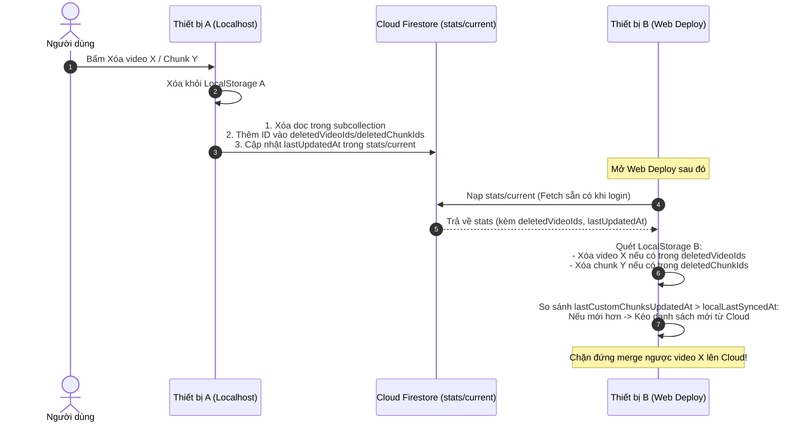

# SPEC-06: Multi-Device Sync & Tombstone Deletion Architecture (Chống Zombie Data)

> **Mã Spec:** SPEC-06  
> **Trạng thái:** 🟢 Approved / Ready for Implementation  
> **Tác giả:** Antigravity & User  
> **Cập nhật lần cuối:** 2026-10-03  
> **Phạm vi:** Đồng bộ đa thiết bị (Localhost, Web Deployed, Mobile Native), Chống hồi sinh dữ liệu đã xóa (Zombie Data), Quản lý Tombstone FIFO & Cập nhật Timestamp thông minh.

---

## 1. Objective (Mục tiêu)

Khi một tài khoản người dùng đăng nhập đồng thời trên nhiều môi trường khác nhau (ví dụ: `localhost:3000`, web production `speaking-english.taiphanvan.id.vn`, và ứng dụng di động Capacitor):
- Hiện tại, nếu người dùng xóa 1 video trong Lịch sử YouTube hoặc xóa 1 chunk từ vựng trên thiết bị A (Localhost), thao tác xóa đã xóa trên Cloud Firestore.
- Tuy nhiên, thiết bị B (Web Deploy) vẫn lưu video/chunk đó trong `localStorage`. Khi thiết bị B mở lên hoặc kích hoạt đồng bộ, hàm `mergeYouTubeHistoryLocalAndCloud` thấy video có ở local nhưng không có trên cloud nên đã **tự động đẩy ngược video đã xóa lên Cloud trở lại (Zombie Data / Dữ liệu hồi sinh)**.
- **Mục tiêu của SPEC-06:** Xây dựng cơ chế **Tombstone Deletion & Timestamp Smart-Sync** với Cloud Firestore làm Single Source of Truth, triệt tiêu 100% hiện tượng Zombie Data mà **không làm phát sinh thêm bất kỳ lượt đọc (0 extra Firestore reads)** nào.

---

## 2. User Story (Câu chuyện người dùng)

- **Là một người dùng EchoChunk học tiếng Anh trên cả máy tính bàn (localhost khi dev), laptop (web deploy) và điện thoại di động:**
- **Tôi muốn:** Khi tôi xóa một video khỏi lịch sử xem hoặc xóa một câu từ vựng trên bất kỳ thiết bị nào, thì khi tôi mở các thiết bị còn lại, các mục đã xóa đó phải tự động biến mất và không bao giờ tự ý xuất hiện trở lại.
- **Tôi mong muốn:** Quá trình đồng bộ diễn ra tức thì, êm ái dưới nền, không gây chậm trễ tải trang và tiết kiệm tối đa tài nguyên mạng/băng thông.

---

## 3. Acceptance Criteria (Tiêu chí nghiệm thu)

1. [ ] **Chống Zombie Video History:** Khi xóa video trên Thiết bị A, Thiết bị B mở lên phải tự động lọc bỏ video đó khỏi `localStorage` của Thiết bị B; tuyệt đối không push ngược video đó lên Firestore.
2. [ ] **Chống Zombie Custom Chunks:** Khi xóa chunk từ vựng trên Thiết bị A, Thiết bị B mở lên phải tự động loại bỏ chunk đó khỏi danh sách từ vựng local.
3. [ ] **Hỗ trợ Clear All History:** Khi người dùng bấm "Xóa toàn bộ lịch sử xem video" trên một thiết bị, mọi thiết bị khác đều nhận biết qua mốc thời gian `videoHistoryClearedAt` và dọn sạch lịch sử local tương ứng.
4. [ ] **Đồng bộ thay đổi thông minh (Timestamp-based Sync):** Khi thêm hoặc sửa chunk trên Thiết bị A, Thiết bị B nhận biết thông qua `lastCustomChunksUpdatedAt > localLastSyncedAt` để tự động kéo bản mới nhất về. Nếu không có thay đổi, sử dụng 100% Cache (0 Read Firestore).
5. [ ] **Tối ưu chi phí Quota Firestore (Zero Extra Reads):** Toàn bộ danh sách Tombstone (`deletedVideoIds`, `deletedChunkIds`) và mốc thời gian đồng bộ được gói gọn trong document `stats/current` vốn đã được fetch sẵn khi nạp app/login.
6. [ ] **Dung lượng an toàn (FIFO 100 IDs):** Mảng Tombstone được giới hạn tối đa 100 ID gần nhất theo cơ chế FIFO, giữ kích thước document `stats/current` luôn dưới vài KB (xa ngưỡng 1MB của Firestore).

---

## 4. UI / UX & Trải nghiệm đồng bộ ngầm

- **Hoàn toàn Silent & Non-blocking:** Quá trình kiểm tra Tombstone và dọn dẹp LocalStorage diễn ra ngầm khi nạp app hoặc khi Auth state hoàn tất. Người dùng không phải chờ màn hình loading.
- **Giao diện phản hồi ngay lập tức (Optimistic UI):**
  - Khi bấm Xóa video hoặc Xóa chunk: Giao diện lập tức biến mất item đó (0ms delay), phát âm thanh click nhẹ, sau đó ngầm đồng bộ lên Firestore.
  - Khi mở thiết bị khác: Dữ liệu đã sạch bóng ngay từ frame đầu tiên sau khi hydration nạp xong.

---

## 5. Architecture, API & Data Contracts

### 5.1. Sơ đồ luồng đồng bộ đa thiết bị (Sequence Diagram)



### 5.2. Mở rộng TypeScript Interface (`src/types/index.ts`)

Bổ sung các trường Tombstone & Sync Timestamps vào `UserStats`:

```typescript
export interface UserStats {
  totalChunksCount?: number;
  customChunksCount?: number;
  studiedCount?: number;
  studyStreakDays?: number;
  lastStudiedDate?: string;
  totalSpeakingTimeSeconds?: number;
  
  // ── SPEC-06: Multi-Device Sync & Tombstones ─────────────────────────────
  /** Danh sách tối đa 100 ID video đã xóa gần nhất (FIFO) */
  deletedVideoIds?: string[];
  /** Danh sách tối đa 100 ID custom chunk đã xóa gần nhất (FIFO) */
  deletedChunkIds?: string[];
  /** Timestamp lần cuối có custom chunk được tạo, sửa hoặc xóa */
  lastCustomChunksUpdatedAt?: number;
  /** Timestamp lần cuối lịch sử xem video có thay đổi (thêm, cập nhật tiến độ, xóa) */
  lastVideoHistoryUpdatedAt?: number;
  /** Timestamp lần cuối người dùng bấm "Xóa toàn bộ lịch sử video" */
  videoHistoryClearedAt?: number;
}
```

### 5.3. Hợp đồng dịch vụ Firestore (Service Contract)

#### A. Khi xóa 1 video (`removeYouTubeHistoryFromCloud`):
```typescript
export async function removeYouTubeHistoryFromCloud(
  uid: string,
  videoId: string
): Promise<void>
```
1. Xóa document `users/{uid}/youtubeHistory/{videoId}`.
2. Cập nhật atomic document `users/{uid}/stats/current`:
   - Append `videoId` vào mảng `deletedVideoIds` (cắt tỉa giữ tối đa 100 phần tử gần nhất).
   - Gán `lastVideoHistoryUpdatedAt = Date.now()`.

#### B. Khi xóa toàn bộ lịch sử video (`clearAllYouTubeHistoryOnCloud`):
```typescript
export async function clearAllYouTubeHistoryOnCloud(uid: string): Promise<void>
```
1. Xóa toàn bộ documents trong subcollection `youtubeHistory` (dùng `writeBatch`).
2. Cập nhật `stats/current`:
   - Gán `videoHistoryClearedAt = Date.now()`.
   - Gán `lastVideoHistoryUpdatedAt = Date.now()`.
   - Reset `deletedVideoIds = []`.

#### C. Khi hợp nhất lịch sử (`mergeYouTubeHistoryLocalAndCloud`):
```typescript
export async function mergeYouTubeHistoryLocalAndCloud(
  uid: string,
  localItems: YouTubeHistoryItem[],
  tombstones?: { deletedVideoIds?: string[]; videoHistoryClearedAt?: number }
): Promise<YouTubeHistoryItem[]>
```
1. **Dọn dẹp Local Items trước khi làm bất cứ điều gì:**
   - Loại bỏ bất kỳ item nào có `videoId` nằm trong `tombstones.deletedVideoIds` (trừ khi `item.lastStudiedAt > deletionTimestamp`).
   - Loại bỏ bất kỳ item nào có `item.lastStudiedAt <= (tombstones.videoHistoryClearedAt || 0)`.
2. Hợp nhất `cloudItems` với các `localItems` còn lại hợp lệ.
3. Chỉ lưu lên Cloud những item hợp lệ thực sự mới hoặc có tiến độ cao hơn.

#### D. Khi xóa custom chunk (`deleteCustomChunk`):
```typescript
export async function deleteCustomChunk(uid: string, chunkId: string): Promise<void>
```
1. Xóa document `users/{uid}/customChunks/{chunkId}`.
2. Cập nhật atomic document `users/{uid}/stats/current`:
   - Append `chunkId` vào `deletedChunkIds` (tối đa 100 phần tử FIFO).
   - Giảm `customChunksCount` và `totalChunksCount`.
   - Gán `lastCustomChunksUpdatedAt = Date.now()`.

#### E. Client Metadata Storage Keys (`src/lib/client/storage.ts`):
```typescript
const LAST_SYNCED_CHUNKS_AT_KEY = "local_last_synced_chunks_at";
const LAST_SYNCED_VIDEO_HISTORY_AT_KEY = "local_last_synced_video_history_at";
```

---

## 6. Error Handling (Xử lý lỗi)

1. **Mất mạng khi xóa (Offline Delete):**
   - Lưu ID vào Local Tombstone (`local_deleted_chunk_ids_v3` hoặc `local_deleted_video_ids`).
   - Ngay khi có mạng trở lại, worker đẩy các ID này lên Cloud Tombstone và xóa document tương ứng trên Firestore.
2. **Document `stats/current` chưa tồn tại hoặc bị lỗi mạng:**
   - Fallback an toàn: Vẫn thực thi xóa ở LocalStorage và tiếp tục cho phép người dùng học bình thường; thử lại (retry) khi online.
3. **Mảng Tombstone chạm ngưỡng 100 IDs:**
   - Tự động áp dụng cơ chế FIFO (First-In, First-Out): Cắt bỏ các ID cũ nhất (`slice(-100)`), chỉ giữ 100 ID mới nhất.

---

## 7. Edge Cases & Conflict Resolution (Các trường hợp biên)

| Tình huống biên | Kịch bản chi tiết | Cơ chế xử lý chuẩn |
| :--- | :--- | :--- |
| **Học lại sau khi đã xóa** | Máy A xóa video X lúc `10:00`. Nhưng lúc `10:05` người dùng lại bấm xem lại video X trên máy B. | `item.lastStudiedAt (10:05) > deletedAt (10:00)`: Hệ thống coi đây là hành động học mới có chủ ý của người dùng $\rightarrow$ Hồi sinh hợp lệ, xóa khỏi mảng `deletedVideoIds`. |
| **Xóa sạch lịch sử trên Máy A, Máy B có cache cũ** | Máy A bấm "Xóa toàn bộ lịch sử" lúc `10:00`. Máy B mở lên lúc `11:00` với 30 video cũ trong cache local. | Máy B thấy `videoHistoryClearedAt = 10:00`. Toàn bộ 30 video có `lastStudiedAt < 10:00` đều bị thanh trừng sạch sẽ khỏi LocalStorage Máy B. |
| **Thêm câu mới trên Localhost, mở Web Deploy** | Localhost tạo chunk mới `chunk_123` và sync lên Cloud (`lastCustomChunksUpdatedAt = 10:00`). Web Deploy mở lên có `localLastSyncedChunksAt = 09:00`. | `10:00 > 09:00`: Web Deploy nhận biết có dữ liệu mới $\rightarrow$ Kéo snapshot mới nhất từ Cloud về LocalStorage $\rightarrow$ Hiển thị tức thì chunk mới. |
| **Không có thay đổi nào** | Người dùng mở app trên Web Deploy bình thường sau khi đã đồng bộ. | `lastCustomChunksUpdatedAt <= localLastSyncedChunksAt`: Dùng 100% Cache LocalStorage, **0 lượt đọc Firestore**. |

---

## 8. UI / System States

- **In-Sync:** Dữ liệu LocalStorage hoàn toàn khớp với Cloud; không có ID nào thuộc Tombstone.
- **Tombstone Purging:** Diễn ra trong ~2ms ngay khi App nạp `stats/current`; loại bỏ các item rác khỏi LocalStorage.
- **Smart Pulling:** Chỉ diễn ra khi phát hiện timestamp trên Cloud mới hơn Local; tải snapshot mới về Cache.

---

## 9. Test Cases (Kịch bản kiểm thử đa thiết bị)

- **Test Case 1 (Xóa 1 video YouTube):**
  1. Mở Localhost: Xem video A (xuất hiện trong Lịch sử).
  2. Mở Web Deploy: Thấy video A xuất hiện trong Lịch sử.
  3. Trên Localhost: Bấm icon Thùng rác xóa video A khỏi Lịch sử.
  4. F5 lại Web Deploy: Xác minh video A đã biến mất và không bao giờ xuất hiện trở lại.
- **Test Case 2 (Xóa toàn bộ lịch sử):**
  1. Cả 2 máy đều có 5 video trong Lịch sử.
  2. Trên Web Deploy: Bấm "Xóa toàn bộ lịch sử".
  3. Mở Localhost: Lịch sử trên Localhost tự động dọn sạch về 0.
- **Test Case 3 (Xóa Custom Chunk):**
  1. Trên Localhost: Tạo 1 chunk mới "Test Chunk Sync".
  2. Mở Web Deploy: Chunk "Test Chunk Sync" xuất hiện.
  3. Trên Localhost: Xóa chunk này.
  4. Mở Web Deploy: Chunk này biến mất khỏi danh sách từ vựng.
- **Test Case 4 (0 Extra Reads Verification):**
  1. Mở tab Network / Firestore rules monitor khi tải trang không có thay đổi.
  2. Xác minh số lượng lượt đọc `customChunks` subcollection bằng đúng 0 khi dữ liệu đã đồng bộ.

---

## 10. Definition of Done (Định nghĩa hoàn thành)

- [ ] Tài liệu `SPEC-06` được phê duyệt và lập chỉ mục trong [docs/specs/README.md](file:///d:/SelfLearning/EchoChunk/docs/specs/README.md).
- [ ] Gõ `pnpm exec tsc --noEmit` và `pnpm run lint` đạt 0 errors, 0 warnings.
- [ ] Interface `UserStats` được cập nhật đầy đủ các trường mới.
- [ ] `youtubeHistory.ts`, `youtubeHistoryStore.ts`, `PracticeContext.tsx` và `customChunks.ts` được nâng cấp theo chuẩn Tombstone FIFO & Timestamp Sync.
- [ ] Thử nghiệm thực tế giữa 2 trình duyệt / môi trường (Localhost vs Web Deploy) xác nhận không còn hiện tượng Zombie Data.

---

## 11. Out of Scope (Ngoài phạm vi)

- Đồng bộ thời gian thực WebRTC / P2P giữa hai máy đang mở cùng lúc (chỉ cần đồng bộ qua Cloud Firestore khi nạp trang / gọi API).
- Quản lý lịch sử chỉnh sửa chi tiết từng ký tự (CRDT / Operational Transformation) cho từng câu ví dụ.
