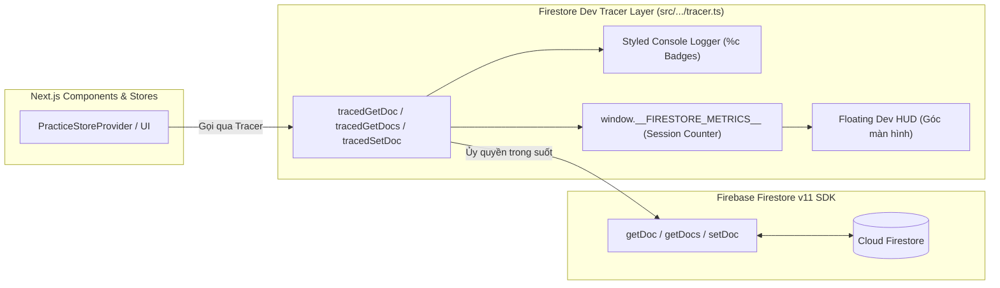

# Kế Hoạch Triển Khai Kỹ Thuật: Firestore Dev Tracing & Quota Observability Suite

> **Tài liệu tham chiếu:** [docs/specs/08-firestore-dev-tracer/spec.md](spec.md) (`SPEC-08`)  
> **Phiên bản:** 1.0  
> **Trạng thái:** 🟢 APPROVED / SẴN SÀNG TRIỂN KHAI  
> **Mục tiêu:** Xây dựng hệ thống quan sát (Observability), đo đạc và truy vết trực quan mọi thao tác đọc/ghi Firestore trong môi trường phát triển (Dev Mode).

---

## 1. Mục Tiêu & Bối Cảnh Kỹ Thuật (Goal Description)

### Vấn Đề (Problem Statement)
- Firebase Firestore Web SDK thiết lập một luồng truyền phát nhị phân duy nhất (`WebChannel` pipe) kết nối từ trình duyệt đến máy chủ Google Cloud.
- Mọi thao tác đọc/ghi (`getDoc`, `getDocs`, `setDoc`, `updateDoc`, `deleteDoc`) đều bị mã hóa và gửi ngầm bên trong luồng này.
- Khi mở tab Network của Chrome DevTools, lập trình viên không thể biết:
  1. Thao tác Firestore nào vừa chạy?
  2. Đường dẫn (Document Path) là gì?
  3. Tốn bao nhiêu Document Reads/Writes tính phí?
  4. Component hoặc Store nào đã kích hoạt truy vấn này?
- Điều này dẫn đến nguy cơ các truy vấn overfetching hoặc vòng lặp re-render âm thầm tiêu thụ hàng ngàn reads quota mà dev không hề hay biết cho đến khi nhận hóa đơn hoặc bị Firebase chặn kết nối.

### Kiến Trúc Giải Pháp Tracing


---

## 2. Kế Hoạch Triển Khai Chi Tiết (Implementation Roadmap)

### Giai đoạn 1: Xây dựng Module `tracer.ts` Cốt Lõi
- **Tập tin:** `src/lib/client/firebase/firestore/tracer.ts`
- **Nội dung:**
  1. Định nghĩa các kiểu dữ liệu `FirestoreTraceLog`, `FirestoreSessionMetrics`.
  2. Khởi tạo đối tượng `window.__FIRESTORE_METRICS__` trên môi trường client với:
     - `totalReads`: Tổng số document reads trong phiên.
     - `totalWrites`: Tổng số document writes trong phiên.
     - `totalDeletes`: Tổng số document deletes trong phiên.
     - `history`: Danh sách tối đa 100 log gần nhất.
     - `summary()`: Bảng `console.table` phân tích theo collection path.
     - `reset()`: Đặt lại toàn bộ bộ đếm.
  3. Xây dựng hàm `logFirestoreOp(op, path, docCount, durationMs, caller, status, error)`:
     - Định dạng màu sắc chuẩn CSS `%c` cho Chrome DevTools Console.
     - Kiểm tra ngưỡng an toàn: Nếu `docCount > 20`, in cảnh báo viền đỏ nổi bật `🚨 [Firestore OVERFETCH WARNING]`.
  4. Xuất các hàm bọc trong suốt (Transparent Wrappers):
     - `tracedGetDoc(docRef, caller?)`
     - `tracedGetDocs(queryRef, caller?)`
     - `tracedSetDoc(docRef, data, options?, caller?)`
     - `tracedUpdateDoc(docRef, data, caller?)`
     - `tracedDeleteDoc(docRef, caller?)`
  5. Đảm bảo cấu trúc kiểm tra `process.env.NODE_ENV === 'development'`. Nếu ở production, hàm chỉ thực thi trực tiếp SDK mà không sinh log hay tốn bộ nhớ.

---

### Giai đoạn 2: Tích Hợp Tracer Vào Toàn Bộ Service Client
Refactor các file service client trong `src/lib/client/firebase/firestore/` chuyển sang gọi qua các hàm bọc:
1. `src/lib/client/firebase/firestore/customChunks.ts`:
   - `getDoc` $\rightarrow$ `tracedGetDoc(..., 'fetchCustomChunks')`
   - `getDocs` $\rightarrow$ `tracedGetDocs(..., 'fetchCustomChunks:legacyFallback')`
   - `setDoc` $\rightarrow$ `tracedSetDoc(..., 'syncCustomChunk')`
   - `updateDoc` $\rightarrow$ `tracedUpdateDoc(..., 'deleteCustomChunk')`
2. `src/lib/client/firebase/firestore/stats.ts`:
   - `getDoc` $\rightarrow$ `tracedGetDoc(..., 'fetchStats')`
   - `setDoc` $\rightarrow$ `tracedSetDoc(..., 'syncStats')`
3. `src/lib/client/firebase/firestore/progress.ts`:
   - `getDoc` $\rightarrow$ `tracedGetDoc(..., 'fetchProgress')`
   - `setDoc` $\rightarrow$ `tracedSetDoc(..., 'syncProgressMap')`
4. `src/lib/client/firebase/firestore/youtubeHistory.ts` & `youtubeTranscript.ts`:
   - Bọc các truy vấn đọc lịch sử và lưu transcript.

---

### Giai đoạn 3: Xây Dựng Floating Dev Tool Component
- **Tập tin:** `src/components/dev/FirestoreQuotaTracer.tsx`
- **Giao diện & Tương tác:**
  - Viên thuốc nhỏ (Glassmorphism Pill) ghim ở góc dưới cùng bên phải màn hình:
    ```
    🔥 Reads: 3 | Writes: 1 | ⏱️ 45ms
    ```
  - Lắng nghe sự kiện cập nhật từ `tracer.ts` để cập nhật số đếm theo thời gian thực (Real-time reactive update).
  - Khi click vào viên thuốc: Mở một Drawer/Popup nhỏ hiển thị danh sách 10 truy vấn gần nhất kèm:
    - Path cụ thể.
    - Thời gian phản hồi (ms).
    - Caller name.
    - Nút "Reset Counter" và "Console Summary".
  - Chỉ render khi `process.env.NODE_ENV === 'development'` (Zero code impact trong build production).
- **Gắn vào layout:** `src/app/layout.tsx`.

---

### Giai đoạn 4: Kiểm Thử & Xác Minh (Verification)
1. **Kiểm tra Console Output:**
   - Mở trình duyệt tại `localhost:3000/shadowing`.
   - Mở Chrome DevTools Console: Kiểm tra các badge `[Firestore READ]` xuất hiện rõ ràng kèm path và thời gian ms.
2. **Kiểm tra Session Metrics:**
   - Gõ `__FIRESTORE_METRICS__.summary()` vào Console và xác nhận bảng tổng hợp hiển thị đúng.
3. **Kiểm tra Dev HUD:**
   - Xác nhận viên thuốc ở góc màn hình phản ánh chính xác số reads/writes sau mỗi thao tác.
4. **Kiểm tra Production Build:**
   - Chạy `pnpm run build` xác nhận không có lỗi build hoặc rò rỉ dev component vào production bundle.

---

## 3. Lịch Trình Thực Hiện (Step-by-Step Execution Plan)

| Bước | Nội dung công việc | Tập tin tác động | Trạng thái |
| :---: | :--- | :--- | :---: |
| **1** | Viết spec và plan theo chuẩn SDD | `docs/specs/08-firestore-dev-tracer/` | ✅ Hoàn thành |
| **2** | Cập nhật Catalog `docs/specs/README.md` | `docs/specs/README.md` | ✅ Hoàn thành |
| **3** | Tạo module `tracer/` (modular: types, logger, metrics, wrappers) | `src/lib/client/firebase/firestore/tracer/` | ✅ Hoàn thành |
| **4** | Tích hợp tracer vào các services Firestore | `src/lib/client/firebase/firestore/*.ts` | ✅ Hoàn thành |
| **5** | Tạo component `FirestoreQuotaTracer.tsx` | `src/components/dev/FirestoreQuotaTracer.tsx` | ✅ Hoàn thành |
| **6** | Gắn component vào `layout.tsx` (Dev only) | `src/app/layout.tsx` | ✅ Hoàn thành |
| **7** | Thiết lập phân tách rõ Server terminal logging & Client Dev Tool | `practiceData.ts`, `metrics.ts`, `FirestoreQuotaTracer.tsx` | ✅ Hoàn thành |
| **8** | Tạo bộ tự động hóa unit test `test_tracer.mjs` (9/9 passed) | `scripts/test_tracer.mjs` | ✅ Hoàn thành |
| **9** | Typecheck, Lint & Build verification | `pnpm exec tsc`, `pnpm run lint`, `pnpm run build` | ✅ Hoàn thành |
