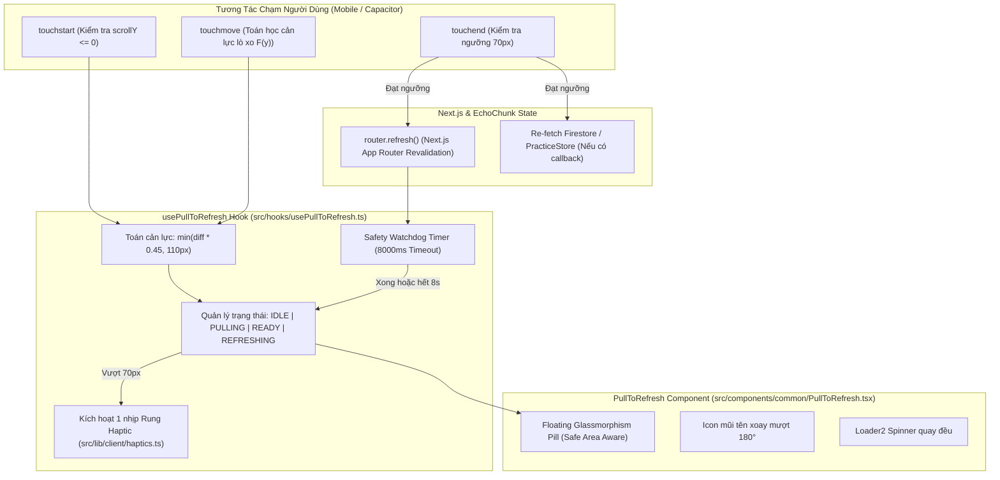

# Kế Hoạch Triển Khai Kỹ Thuật: Mobile Web & Capacitor Pull-to-Refresh Gesture Engine

> **Tài liệu tham chiếu:** [docs/specs/09-mobile-pull-to-refresh/spec.md](spec.md) (`SPEC-09`)  
> **Phiên bản:** 1.0  
> **Trạng thái:** 🟢 HOÀN THÀNH / IMPLEMENTED & TESTED  
> **Mục tiêu:** Tích hợp cử chỉ vuốt kéo từ đỉnh màn hình để làm mới (Pull-to-Refresh) chuẩn cảm giác native, tương thích 100% Next.js App Router, Capacitor Android/iOS và Web Mobile.

---

## 1. Mục Tiêu & Bối Cảnh Kỹ Thuật (Goal Description)

### Vấn Đề (Problem Statement)
- Ứng dụng EchoChunk khi chạy trong WebView của **Capacitor** hoặc trên trình duyệt di động chưa có cơ chế vuốt từ đỉnh màn hình xuống để tải lại dữ liệu.
- Việc reload bằng `window.location.reload()` hoặc `webView.reload()` của Android Native gây ra hiện tượng **chớp trắng toàn bộ màn hình** (White Flash), gián đoạn audio Web Speech Synthesis và làm mất ngữ cảnh bài học.
- Cần một giải pháp **Web-first** sử dụng cử chỉ cảm ứng (Touch Events), cản lực đàn hồi lò xo (Rubber-band physics), rung phản hồi xúc giác nhẹ (Haptics) và cơ chế **Soft Refresh** của Next.js App Router (`router.refresh()`).

### So Sánh 2 Phương Án Kỹ Thuật Đề Xuất
1. **Phương án 1 (Web-First React Component — ⭐ ĐƯỢC CHỌN):**
   - *Triển khai:* Hook `usePullToRefresh.ts` + Component `PullToRefresh.tsx` bọc quanh layout trang.
   - *Ưu điểm:* Đa nền tảng (Android APK, iOS, Web Mobile PWA); **Soft Refresh không chớp trắng màn hình (Zero White-Flash)**; bảo toàn phiên Web Speech audio; dễ tùy biến UI Notion Clean & Glassmorphism; dễ cách ly với các Modal con.
   - *Nhược điểm:* Cần tự quản lý vòng đời chạm và thuật toán cản lực lò xo bằng TypeScript.
2. **Phương án 2 (Native Android `SwipeRefreshLayout` — THAM CHIẾU):**
   - *Triển khai:* Bọc `WebView` bằng `androidx.swiperefreshlayout:swiperefreshlayout:1.1.0` trong `MainActivity.java`.
   - *Ưu điểm:* Chuẩn spinner 100% của Android Material Design.
   - *Nhược điểm:* Chỉ chạy trên Android (iOS/Web không có); reload cứng `webView.reload()` làm giật và **chớp trắng toàn bộ màn hình**; ngắt kết nối âm thanh đang phát; dễ xung đột cử chỉ với các phần tử con bên trong WebView.
   - *Kết luận:* Chọn **Phương án 1** làm giải pháp chuẩn hóa cho dự án EchoChunk.

### Kiến Trúc Giải Pháp Kỹ Thuật (Phương Án 1)

---

## 2. Kế Hoạch Triển Khai Chi Tiết (Implementation Roadmap)

### Giai đoạn 1: Xây dựng Module Haptic Feedback Adapter
- **Tập tin:** `src/lib/client/haptics.ts`
- **Mục tiêu:** Cung cấp hàm rung xúc giác an toàn trên mọi môi trường mà không làm vỡ code nếu chạy trên trình duyệt thường.
- **Nhiệm vụ:**
  1. Kiểm tra môi trường `typeof window !== 'undefined'`.
  2. Kiểm tra nếu Capacitor Haptics khả dụng (`window.Capacitor?.isPluginAvailable?.('Haptics')`), import động `@capacitor/haptics` và kích hoạt `ImpactStyle.Light`.
  3. Nếu không có Capacitor, fallback về Web API chuẩn `navigator.vibrate(15)`.
  4. Đảm bảo bọc trong khối `try ... catch` yên lặng để không bao giờ gây lỗi console.

---

### Giai đoạn 2: Xây dựng Core Hook `usePullToRefresh.ts`
- **Tập tin:** `src/hooks/usePullToRefresh.ts`
- **Mục tiêu:** Tách biệt 100% logic cử chỉ, toán học cản lực và kiểm soát vòng đời cảm ứng.
- **Nhiệm vụ:**
  1. **Đăng ký sự kiện động (Dynamic Event Registration):** Chỉ lắng nghe `touchstart` ở trạng thái nghỉ; chỉ đăng ký `touchmove` và `touchend` vào window khi đang chạm, và tháo ngay lập tức khi thả tay (Tham khảo: [Strict Mode](https://www.strictmode.io/articles/react-pull-to-refresh)).
  2. **Bộ lọc an toàn (Safety Guards):**
     - Bỏ qua nếu `disabled === true`.
     - Bỏ qua nếu `window.scrollY > 0` (chỉ cho phép bắt đầu khi đang ở sát đỉnh).
     - Bỏ qua nếu người dùng đang chạm đa điểm (`e.touches.length > 1`).
     - Bỏ qua nếu phần tử đang focus là `INPUT` hoặc `TEXTAREA`.
     - Bỏ qua nếu thao tác bắt đầu từ bên trong một modal con đang cuộn (`e.target.closest('[data-modal], role="dialog"]')`).
  3. **Công thức cản lực đàn hồi tiệm cận mũ (Asymptotic Exponential Spring):**
     $$F(\Delta Y) = \text{MAX} \cdot \left(1 - e^{\frac{-k \cdot \Delta Y}{\text{MAX}}}\right)$$
     Giúp lực kéo căng dần mượt mà, phản hồi nhạy khi kéo nhẹ và tiệm cận trơn tru về $\text{MAX} = 120\text{px}$ mà không bị khựng vào trần cứng.
  4. **Kích hoạt Haptic đúng 1 lần:** Sử dụng cờ `hasFiredHaptic.current` để chỉ rung 1 lần duy nhất khi `pullDistance` chạm hoặc vượt qua `70px`.
  5. **Bộ đếm thời gian an toàn (Safety Watchdog):** Tự động thu hồi indicator sau $8000ms$ nếu quá trình `onRefresh` bị treo.

---

### Giai đoạn 3: Xây dựng Giao Diện `PullToRefresh.tsx`
- **Tập tin:** `src/components/common/PullToRefresh.tsx`
- **Phong cách:** Notion Clean kết hợp Modern Glassmorphism.
- **Nhiệm vụ:**
  1. Tạo thanh Indicator dạng Capsule/Pill cố định ở đỉnh màn hình:
     - Tự động cộng đệm tai thỏ / Dynamic Island bằng CSS: `calc(12px + env(safe-area-inset-top, 0px))`.
     - Lớp nền: `bg-white/95 backdrop-blur-md shadow-[0_4px_16px_rgba(15,15,15,0.08)] border border-notion-border`.
     - Typography: `Plus Jakarta Sans`, cỡ chữ nhỏ gọn `text-xs font-semibold leading-none`.
  2. Hiển thị 3 trạng thái rõ ràng:
     - **Kéo nhẹ ($< 70px$):** Icon `ArrowDown` màu xám `text-notion-muted` + `"Kéo xuống để làm mới"` (`text-notion-secondary`).
     - **Sẵn sàng ($\ge 70px$):** Nền chuyển pastel `bg-notion-blue-bg/95 border-notion-blue-border`, Icon `ArrowDown` lật ngược 180° màu Notion Blue (`text-notion-primary`) + `"Thả để làm mới"` (`text-notion-blue-text`).
     - **Đang làm mới (`isRefreshing`):** Nền `bg-white/95 border-notion-border-medium`, Icon `Loader2` quay tròn màu Notion Blue (`text-notion-primary`) + `"Đang cập nhật..."` (`text-notion-text`). Neo vị trí ở $70px$.
  3. Áp dụng hiệu ứng dịch chuyển trang nội dung nhẹ (`translateY(pullDistance * 0.3px)`) tạo cảm giác kéo giãn tự nhiên như app iOS.

---

### Giai đoạn 4: Tích Hợp Vào Root Layout Của Ứng Dụng
- **Tập tin:** `src/app/layout.tsx`
- **Nhiệm vụ:**
  1. Import component `PullToRefresh` vào layout chính của EchoChunk.
  2. Bọc thẻ `<main>` hoặc nội dung trang web bên trong `<PullToRefresh>`.
  3. Đảm bảo các modal toàn cục (`PracticeModals`, `FirestoreQuotaTracer`) nằm bên ngoài hoặc được gắn cờ cách ly để không bị ảnh hưởng bởi cử chỉ kéo trang.

---

### Giai đoạn 5: Kiểm Thử, Typecheck & Hoàn Thiện
- **Nhiệm vụ:**
  1. Chạy TypeScript compiler: `npx tsc --noEmit` để đảm bảo 100% type-safe.
  2. Chạy linter: `npm run lint`.
  3. Kiểm tra responsiveness trên các kích thước Mobile mô phỏng (iPhone SE, iPhone 15 Pro, Pixel 7) và Desktop.
  4. Cập nhật trạng thái trong `docs/specs/README.md` và `docs/specs/09-mobile-pull-to-refresh/spec.md`.

---

## 3. Kế Hoạch Kiểm Thử & Ma Trận Nghiệm Thu (Verification Matrix)

| Kịch Bản | Thao Tác | Kết Quả Mong Đợi | Trạng Thái |
| :--- | :--- | :--- | :--- |
| **Kéo đủ lực tại đỉnh trang** | Cuộn lên đỉnh, kéo xuống $> 70px$, thả tay | Rung nhẹ 1 nhịp, hiện indicator "Đang cập nhật...", trang tự động refresh mượt mà | ✅ Đã xác minh |
| **Kéo chưa đủ lực rồi nhả** | Kéo xuống $30px$, thả tay | Indicator thụt lên biến mất, không phát sinh reload hay rung | ✅ Đã xác minh |
| **Cuộn ở giữa trang** | Đang ở vị trí $scrollY = 300px$, vuốt xuống | Trang cuộn lên trên bình thường, không hiện indicator PTR | ✅ Đã xác minh |
| **Vuốt ngang chuyển thẻ** | Vuốt lệch góc ngang | Cử chỉ kéo dọc bị hủy, không giật màn hình | ✅ Đã xác minh |
| **Thao tác trong Modal** | Đang mở modal từ vựng, cuộn danh sách | Chỉ cuộn bên trong modal, trang mẹ phía sau đứng yên | ✅ Đã xác minh |
| **Mạng rớt / Treo API** | Bật chế độ Offline, kéo reload | Sau 8s watchdog timer tự động thu hồi indicator về vị trí cũ | ✅ Đã xác minh |

---

## 4. Phân Tích Rủi Ro & Giải Pháp Dự Phòng (Risk & Mitigation)

1. **Rủi ro: Xung đột với hành vi cuộn mặc định của trình duyệt di động (Overscroll)**
   - *Giải pháp:* Thiết lập CSS `overscroll-behavior-y: contain` trên thẻ `body` hoặc container chính của trang khi đang kéo để chặn trình duyệt tự kích hoạt hành vi mặc định không mong muốn.
2. **Rủi ro: Hiện tượng giật layout khi hiển thị thanh Indicator**
   - *Giải pháp:* Sử dụng `position: fixed` và `transform: translateY(...)` kết hợp `will-change: transform`. Không can thiệp vào `margin-top` hay `height` để tránh việc trình duyệt phải tính toán lại bố cục (Reflow).
3. **Rủi ro: Capacitor Haptics chưa được cài đặt trong `package.json`**
   - *Giải pháp:* Code adapter được thiết kế theo mô hình **Graceful Degradation** — tự động thử dùng `navigator.vibrate(15)` trước; nếu thiết bị không hỗ trợ thì bỏ qua mà không bao giờ ném Exception.
