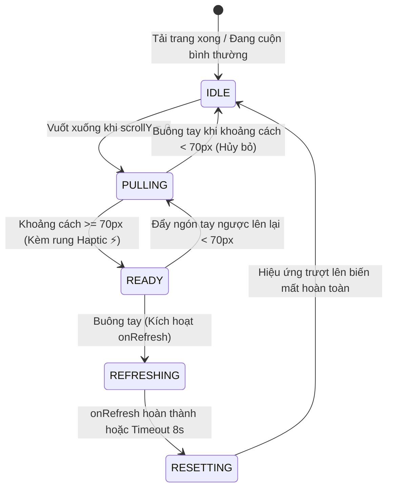

# Feature Specification: Mobile Web/Capacitor Native-feel Pull-to-Refresh Gesture Engine

> **Feature:** Mobile Web & Capacitor Pull-to-Refresh Gesture Engine (Kéo Vuốt Làm Mới Mượt Mà Chuẩn Native)  
> **Version:** 1.0  
> **Date:** 2026-10-04  
> **Author:** Antigravity AI & EchoChunk Engineering Team  
> **Spec ID:** `SPEC-09`  
> **Status:** 🟢 APPROVED / IMPLEMENTED & TESTED  
> **Target Subsystem:** Frontend Components (`src/components/common/PullToRefresh.tsx`), Touch Gesture Hooks (`src/hooks/usePullToRefresh.ts`), Root Layout (`src/app/layout.tsx`), Capacitor Haptics Integration  
> **Format Standard:** 11-Part Industry Standard Feature Specification (*Anatomy of a Good Feature Spec*)  
> **Kế Hoạch Triển Khai:** [plan.md](plan.md)  

---

## 🎯 1. Objective (Mục Tiêu)

- **Giải quyết thiếu sót trải nghiệm cốt lõi trên Mobile:**
  - Ứng dụng EchoChunk khi đóng gói qua **Capacitor** hoặc mở trên trình duyệt di động (iOS Safari / Android Chrome) hiện chưa có cơ chế vuốt kéo từ đỉnh màn hình xuống để làm mới dữ liệu (**Pull-to-Refresh - PTR**). Người dùng di động vốn có thói quen tiềm thức này từ các ứng dụng native (Facebook, Twitter/X, Duolingo, Notion).
  - Thiếu tính năng này buộc người dùng phải tìm kiếm nút reload thủ công hoặc tắt ứng dụng mở lại khi muốn đồng bộ dữ liệu mới nhất (tiến độ ôn tập SRS, cụm Chunk mới tạo từ máy tính khác, hoặc khôi phục trạng thái mạng).
- **Trải nghiệm SPA Mượt Mà (Zero White-flash):**
  - Khác với cơ chế `webView.reload()` cứng của Android Native (làm trắng màn hình, ngắt kết nối âm thanh và tải lại toàn bộ tài nguyên tĩnh HTML/CSS), giải pháp này sử dụng **Soft Refresh** (thông qua `router.refresh()` của Next.js App Router hoặc re-fetch các Zustand Store/Firestore Listeners) giúp giao diện cập nhật tức thì trong êm ái mà không bị chớp màn hình.
- **Tính Tương Thích Tuyệt Đối (Universal Web & Capacitor):**
  - Hoạt động đồng nhất 100% trên cả ứng dụng Android APK (Capacitor), iOS (nếu build sau này), Mobile PWA và trình duyệt di động.
  - Tích hợp phản hồi rung xúc giác nhẹ (**Haptic Feedback**) thông qua Capacitor Haptics / Web Vibration API khi kéo đạt ngưỡng kích hoạt, mang lại cảm giác chân thật như ứng dụng thuần Native.

### 1.1. Phân Tích & So Sánh 2 Phương Án Kỹ Thuật (Architecture Decision Record - ADR)

Dự án đã nghiên cứu và đối chiếu 2 phương án kỹ thuật triển khai Pull-to-Refresh:

| Tiêu Chí So Sánh | Phương Án 1: Web-First React Component (⭐ Được Chọn) | Phương Án 2: Native Android `SwipeRefreshLayout` (Tham Chiếu) |
| :--- | :--- | :--- |
| **Phạm vi hỗ trợ** | **Đa nền tảng:** Cả Android APK (Capacitor), iOS, Mobile PWA và trình duyệt di động | **Đơn nền tảng:** Chỉ riêng Android (iOS cần viết riêng bằng Swift `UIRefreshControl`) |
| **Cơ chế tải lại** | **Soft Refresh:** Gọi `router.refresh()` của Next.js hoặc re-fetch Store, **hoàn toàn không chớp trắng màn hình (Zero White-Flash)** | **Hard Reload:** Gọi `webView.reload()`, tải lại toàn bộ HTML/JS, gây giật lag và chớp trắng màn hình |
| **Bảo tồn trạng thái** | Giữ nguyên kết nối âm thanh Web Speech Synthesis, audio phát âm và tiến độ học tập | Ngắt đột ngột mọi luồng audio đang phát, reset toàn bộ state client |
| **Khả năng cách ly cuộn** | Kiểm soát 100% trong React, dễ dàng bỏ qua khi đang cuộn Modal (`ChunkModal`, `PracticeModals`) | Dễ xung đột cử chỉ (Gesture conflict) giữa `SwipeRefreshLayout` và WebView con |
| **Thẩm mỹ giao diện** | Tùy biến phong cách **Notion Clean & Glassmorphism**, đồng bộ màu sắc thương hiệu EchoChunk | Sử dụng vòng xoay spinner mặc định của Android Material Design |
| **Can thiệp Native** | Giữ nguyên mã nguồn Java/Kotlin, hạn chế tối đa rủi ro vỡ build Gradle | Cần sửa `MainActivity.java` và thêm thư viện AndroidX vào `build.gradle` |

#### Đánh giá chi tiết từng phương án:

1. **Phương Án 1 — Web-First Component (`PullToRefresh.tsx` + `usePullToRefresh.ts`) — [APPROVED]:**
   - *Nguyên lý:* Lắng nghe Touch Events (`touchstart`, `touchmove`, `touchend`) trên tầng React. Áp dụng công thức cản lực đàn hồi lò xo phi tuyến tính $F(y) = \min(y \times 0.45, 110\text{px})$. Hiển thị Capsule Pill Glassmorphism nổi, kích hoạt rung Haptic nhẹ và gọi Next.js `router.refresh()`.
   - *Lý do phê duyệt:* Đảm bảo tính nhất quán trên mọi nền tảng, đem lại cảm giác mượt mà không chớp màn hình, phù hợp hoàn hảo với kiến trúc Next.js App Router và Zustand của EchoChunk.

2. **Phương Án 2 — Native Android `SwipeRefreshLayout` trong `MainActivity.java` — [THAM CHIẾU NATIVE]:**
   - *Nguyên lý:* Bọc `WebView` của Capacitor bằng `SwipeRefreshLayout` trong Java Native.
   - *Mã nguồn tham khảo cho Android:*
     ```groovy
     // android/app/build.gradle
     dependencies {
         implementation "androidx.swiperefreshlayout:swiperefreshlayout:1.1.0"
     }
     ```
     ```java
     // android/app/src/main/java/com/echochunk/app/MainActivity.java
     swipeRefreshLayout = new SwipeRefreshLayout(this);
     ViewGroup parent = (ViewGroup) webView.getParent();
     if (parent != null) {
         int index = parent.indexOfChild(webView);
         ViewGroup.LayoutParams params = webView.getLayoutParams();
         parent.removeView(webView);
         swipeRefreshLayout.addView(webView, new ViewGroup.LayoutParams(
             ViewGroup.LayoutParams.MATCH_PARENT, ViewGroup.LayoutParams.MATCH_PARENT
         ));
         parent.addView(swipeRefreshLayout, index, params);
     }
     // Chống xung đột cuộn khi đang ở giữa trang:
     swipeRefreshLayout.setOnChildScrollUpCallback((layout, child) -> webView.canScrollVertically(-1));
     swipeRefreshLayout.setOnRefreshListener(() -> webView.reload());
     // Tắt vòng xoay khi trang nạp xong trong BridgeWebChromeClient:
     // if (newProgress >= 100 && swipeRefreshLayout != null) swipeRefreshLayout.setRefreshing(false);
     ```
   - *Lý do không chọn làm mặc định:* Cách này tải lại toàn bộ trang web (F5 cứng), gây chớp trắng màn hình, làm mất âm thanh đang phát và không áp dụng được cho phiên bản iOS/Web PWA.

---

## 👤 2. User Story (Câu Chuyện Người Dùng)

> **Là một** người dùng đang học tiếng Anh trên điện thoại thông qua ứng dụng di động EchoChunk (Capacitor APK hoặc Mobile Browser),  
> **Tôi muốn** có thể chạm ngón tay vào đỉnh màn hình và kéo nhẹ xuống dưới để kích hoạt cơ chế tải lại/đồng bộ dữ liệu,  
> **Để** tôi có được cảm giác điều hướng tự nhiên, trực quan như ứng dụng Native, nhanh chóng cập nhật danh sách bài học và tiến độ ôn tập mới nhất mà không bị gián đoạn trải nghiệm học tập.

---

## ✅ 3. Acceptance Criteria (Tiêu Chí Nghiệm Thu)

- [x] **AC-1 (Strict Top-of-Page Detection & Directional Lock):**
  - Cử chỉ kéo chỉ được phép bắt đầu khi và chỉ khi vị trí cuộn trang đang ở sát đỉnh (`window.scrollY <= 0` hoặc phần tử cuộn gốc `scrollTop === 0`).
  - Phải có cơ chế khóa hướng (Directional Lock): Nếu góc vuốt bị lệch ngang (người dùng vuốt chuyển tab hoặc xem flashcard), cử chỉ kéo dọc phải bị hủy bỏ ngay lập tức để không gây giật lag giao diện.
- [x] **AC-2 (Asymptotic Exponential Spring Resistance):**
  - Quãng đường di chuyển của giao diện áp dụng công thức cản lực đàn hồi tiệm cận mũ (Tham khảo: [Strict Mode](https://www.strictmode.io/articles/react-pull-to-refresh)):
    $$F(\Delta Y) = \text{MAX} \cdot \left(1 - e^{\frac{-k \cdot \Delta Y}{\text{MAX}}}\right)$$
  - Giúp lực kéo tăng dần mượt mà theo độ căng, phản hồi nhạy khi kéo nhẹ và tiệm cận trơn tru về $\text{MAX} = 120\text{px}$ mà không bị khựng vào trần cứng.
- [x] **AC-3 (Floating Glassmorphism Indicator & Statuses):**
  - Hiển thị thanh Capsule/Pill nổi bật với 3 trạng thái phản hồi rõ nét:
    1. *Kéo chưa tới ngưỡng ($< 70px$):* Icon mũi tên hướng xuống màu xám, text `"Kéo xuống để làm mới"`.
    2. *Đã đạt ngưỡng ($70px \le d \le 110px$):* Icon mũi tên xoay mượt 180° chuyển sang màu xanh tím thương hiệu, text `"Thả để làm mới"`.
    3. *Đang làm mới (Refreshing):* Icon xoay tròn `Loader2` vô tận, text `"Đang cập nhật..."`. Vị trí neo (`refreshingHoldDistance`) được đồng bộ chuẩn xác với ngưỡng kích hoạt ($70\text{px}$), giữ cố định liền mạch tại vị trí người dùng vừa buông tay mà không bị nhảy vọt độ cao.
- [x] **AC-4 (Tactile Haptic Feedback):**
  - Đúng khoảnh khắc ngón tay kéo vượt qua ngưỡng kích hoạt ($70px$), hệ thống phát ra một nhịp rung nhẹ duy nhất (`ImpactStyle.Light` qua Capacitor Haptics hoặc `navigator.vibrate(15)`). Nhịp rung chỉ kích hoạt 1 lần duy nhất trong 1 phiên vuốt kéo.
- [x] **AC-5 (Hard Reload / F5 & Custom Async Callback):**
  - Khi thả tay ở trạng thái sẵn sàng, component gọi hàm `onRefresh()` (bất đồng bộ) nếu được truyền vào.
  - Nếu không truyền `onRefresh`, mặc định luôn thực hiện **Hard Reload** nạp lại toàn bộ trang từ đầu y hệt phím F5 (`window.location.reload()`).
  - Khi ngón tay vừa nhấc ra (`touchend`), cờ `isPulling` chuyển ngay về `false` để kích hoạt đường cong hồi đàn hồi tự nhiên `cubic-bezier(0.16, 1, 0.3, 1)`. Indicator xoay mượt mà trước khi trang được nạp mới hoàn toàn.
- [x] **AC-6 (Safe-Area & Zero-Jerk Layout Stability):**
  - Thanh Indicator tự động thích ứng với khoảng đệm tai thỏ / Dynamic Island và chiều cao thực tế của `header` qua dynamic `topOffset`.
  - Kích thước badge được cố định chuẩn mực (`h-8` 32px, `min-w-[152px]`, `leading-none`) kết hợp `transition-all duration-200 ease-out`, triệt tiêu hoàn toàn hiện tượng giật ngang/dọc khi đổi text hoặc đổi icon giữa các trạng thái.
  - Không làm xô lệch hoặc giật bố cục các thanh cố định khác như `Navbar` hay `Footer`.
- [x] **AC-7 (Modal & Child Scroll Isolation):**
  - Tuyệt đối không kích hoạt PTR khi người dùng đang cuộn nội dung bên trong các hộp thoại con (Dialogs / Modals như `ChunkModal`, `PracticeModals`, `QuotaTracerSheet`, hoặc vùng xem video YouTube).
- [x] **AC-8 (Desktop Immunity):**
  - Cơ chế tự động tắt hoặc không gây cản trở trên màn hình máy tính để bàn (Desktop / Laptop) dùng chuột cuộn thông thường.

---

## 🎨 4. UI / UX (Giao Diện & Trải Nghiệm Thẩm Mỹ)

### 4.1. Phong Cách Thiết Kế (Notion Clean Light & Modern Glassmorphism)
- **Hình dáng:** Capsule Pill bo tròn mềm mại (`rounded-full`), đổ bóng đa lớp chuẩn Notion (`shadow-[0_4px_16px_rgba(15,15,15,0.08)]`).
- **Chất liệu nền:** `bg-white/95 backdrop-blur-md` viền siêu mảnh chuẩn Notion (`border border-notion-border` / `border-notion-border-medium`).
- **Màu sắc điểm nhấn:** Chuẩn Notion Brand Blue (`notion-primary: #2383e2`, `notion-blue-text: #0b6e99`, `notion-blue-bg: #e8f4fd`) đồng bộ 100% với hệ thống Design System của EchoChunk.
- **Typography:** Phông chữ `Plus Jakarta Sans`, kích thước `text-xs font-semibold tracking-wide`, `leading-none`.

### 4.2. Sơ Đồ Chuyển Động Trực Quan (Gesture Anatomy)

```
[ Đỉnh màn hình Mobile (Safe Area) ]
      │
      ▼  (Ngón tay chạm và kéo xuống: Y = 0 -> 40px)
 ╭─────────────────────────────────╮
 │  ↓  Kéo xuống để làm mới...    │  <-- Mũi tên xám (text-notion-muted), cản lực êm
 ╰─────────────────────────────────╯
      │
      ▼  (Kéo vượt ngưỡng: Y >= 70px)  ==> [RUNG NHẸ HAPTIC ⚡]
 ╭─────────────────────────────────╮
 │  ↑  Thả để làm mới             │  <-- Mũi tên lật 180°, chuyển Notion Blue (#2383e2)
 ╰─────────────────────────────────╯
      │
      ▼  (Thả tay ra: Buông ngón tay)
 ╭─────────────────────────────────╮
 │  ⟳  Đang cập nhật...            │  <-- Neo ở Y = 70px (trùng ngưỡng), xoay Spinner xanh Notion vô tận
 ╰─────────────────────────────────╯
      │
      ▼  (Hoàn thành nạp dữ liệu: 0.25s trượt lên biến mất)
```

---

## 🔌 5. API & Service Contract (Hợp Đồng Dịch Vụ)

### 5.1. Types & Interfaces (`src/components/common/PullToRefresh.tsx`)

```typescript
export interface PullToRefreshProps {
  /** Các component con bên trong trang web */
  children: React.ReactNode;
  
  /** 
   * Hàm callback bất đồng bộ chạy khi người dùng kéo thả để làm mới.
   * Nếu không truyền, mặc định gọi Next.js `router.refresh()`.
   */
  onRefresh?: () => Promise<void> | void;
  
  /** Ngưỡng khoảng cách kéo tối thiểu để kích hoạt (Mặc định: 70px) */
  threshold?: number;
  
  /** Khoảng cách kéo tối đa cho phép giao diện giãn ra (Mặc định: 110px) */
  maxPullDistance?: number;
  
  /** Bật/Tắt tính năng rung xúc giác Haptic (Mặc định: true) */
  enableHaptics?: boolean;
  
  /** Bật/Tắt hoàn toàn tính năng PTR (Mặc định: false) */
  disabled?: boolean;

  /** Vị trí neo (px) của indicator khi đang tải dữ liệu (Mặc định bằng threshold: 70px) */
  refreshingHoldDistance?: number;
}
```

### 5.2. Custom Hook Tách Biệt Nghiệp Vụ (`src/hooks/usePullToRefresh.ts`)

```typescript
export interface UsePullToRefreshOptions {
  threshold?: number;
  maxPull?: number;
  enableHaptics?: boolean;
  disabled?: boolean;
  onRefresh: () => Promise<void> | void;
}

export interface UsePullToRefreshReturn {
  containerRef: React.RefObject<HTMLDivElement | null>;
  pullDistance: number;
  isRefreshing: boolean;
  isReadyToRelease: boolean;
  isPulling: boolean;
}
```

### 5.3. Tiện Ích Rung Xúc Giác Haptic Adapter (`src/lib/client/haptics.ts`)

```typescript
/**
 * Hỗ trợ rung đa nền tảng: Ưu tiên Capacitor Haptics Plugin,
 * nếu không có fallback về HTML5 navigator.vibrate()
 */
export async function triggerLightHaptic(): Promise<void> {
  try {
    // 1. Kiểm tra Capacitor Haptics nếu plugin có sẵn
    if (typeof window !== "undefined" && (window as any).Capacitor?.isPluginAvailable?.("Haptics")) {
      const { Haptics, ImpactStyle } = await import("@capacitor/haptics");
      await Haptics.impact({ style: ImpactStyle.Light });
      return;
    }
    // 2. Fallback sang Web API chuẩn
    if (typeof navigator !== "undefined" && typeof navigator.vibrate === "function") {
      navigator.vibrate(15);
    }
  } catch {
    // Yên lặng bỏ qua nếu thiết bị không hỗ trợ rung
  }
}
```

---

## ⚠️ 6. Error Handling (Xử Lý Lỗi Ngoại Lệ)

1. **Sự Cố Treo Mạng / Infinite Loading Hang:**
   - Nếu hàm `onRefresh()` gọi API mạng bị treo hoặc Promise không bao giờ resolve, một bộ đếm thời gian an toàn (**Safety Watchdog Timeout: 8000ms**) sẽ tự động can thiệp, tắt trạng thái `isRefreshing = false` và thu hồi indicator về vị trí ban đầu. Người dùng không bao giờ bị "kẹt chết" giao diện.
2. **Lỗi Promise Rejection:**
   - Toàn bộ khối xử lý refresh được bọc trong `try ... finally`. Cho dù xảy ra lỗi mạng hay lỗi runtime, thanh indicator vẫn luôn được bảo đảm trả về vị trí gốc mà không làm crash ứng dụng.
3. **Mất Kết Nối Mạng (Offline):**
   - Trong môi trường Offline, Next.js `router.refresh()` sẽ đọc từ Service Worker / Cache cục bộ. Nếu thất bại, hiển thị thông báo nhẹ và duy trì dữ liệu hiển thị hiện tại.

---

## 🔍 7. Edge Cases (Các Trường Hợp Biên)

| Tình huống biên | Cách xử lý kỹ thuật |
| :--- | :--- |
| **Momentum Bounce trên iOS Safari** | Khi cuộn nhanh chạm đỉnh, iOS tạo hiệu ứng nảy tự nhiên. Hệ thống phát hiện vận tốc và chỉ kích hoạt PTR khi `e.touches[0].clientY` bắt đầu từ trạng thái đứng yên tại đỉnh (`scrollY === 0`). |
| **Cuộn bên trong Modal con / Accordion** | Kiểm tra `e.target`: Nếu sự kiện touch phát sinh từ một phần tử con có `overflow-y: auto / scroll` đang chưa ở đỉnh, PTR của trang ngoài sẽ chủ động bỏ qua. |
| **Chạm đa điểm (Multi-touch Pinch/Zoom)** | Chỉ theo dõi touch đầu tiên (`e.touches.length === 1`). Nếu phát hiện chạm 2 ngón tay trở lên, lập tức reset quãng đường kéo về 0 để nhường quyền cho cử chỉ Zoom. |
| **Đang mở bàn phím ảo (Virtual Keyboard)** | Khi `document.activeElement` là thẻ `INPUT` hoặc `TEXTAREA`, vô hiệu hóa cử chỉ PTR để tránh vô tình kích hoạt khi người dùng vuốt bàn phím hoặc chọn text. |
| **Desktop Mouse Drag** | Chỉ lắng nghe sự kiện `TouchEvent` (`touchstart`, `touchmove`, `touchend`), không gắn vào sự kiện chuột máy tính (`mousedown`), tránh ảnh hưởng thao tác bôi đen chữ trên Desktop. |

---

## 📱 8. UI States (Các Trạng Thái Giao Diện)



1. **`IDLE` (Nghỉ):** Thanh Indicator ẩn (`opacity: 0`, `translateY: -20px`), nội dung trang ở tọa độ gốc.
2. **`PULLING` (Đang kéo):** Indicator di chuyển xuống tỉ lệ thuận với lực kéo; icon mũi tên chỉ xuống màu xám.
3. **`READY` (Sẵn sàng):** Mũi tên lật 180° chuyển sang màu tím thương hiệu; rung nhẹ haptic 1 lần.
4. **`REFRESHING` (Đang làm mới):** Neo ở vị trí $50px$; Spinner quay đều; nội dung trang đệm xuống $45px$.
5. **`RESETTING` (Khôi phục):** Trượt êm ái về vị trí 0px trong $250ms$; mở khóa hoàn toàn tương tác của người dùng.

---

## 🧪 9. Test Cases (Kịch Bản Kiểm Thử)

| Mã TC | Tình huống kiểm thử | Các bước thực hiện | Kết quả mong đợi |
| :--- | :--- | :--- | :--- |
| **TC-01** | Kéo đủ lực tại đỉnh trang | Đứng ở đầu trang, kéo ngón tay xuống $> 70px$ rồi thả tay | Nghe/cảm nhận 1 nhịp rung nhẹ, indicator hiện "Đang cập nhật...", trang thực hiện refresh mượt mà. |
| **TC-02** | Kéo chưa đủ lực | Kéo ngón tay xuống khoảng $35px$ rồi thả tay | Indicator tự đàn hồi thụt lên trên biến mất, không phát sinh reload hay rung haptic. |
| **TC-03** | Thao tác khi đang ở giữa trang | Cuộn trang xuống $200px$, thực hiện vuốt kéo từ trên xuống | Trang cuộn lên bình thường, tuyệt đối không xuất hiện thanh PTR indicator. |
| **TC-04** | Cuộn bên trong Modal thực hành | Mở `ChunkModal` hoặc `PracticeModal`, cuộn danh sách bên trong | Chỉ cuộn danh sách bên trong Modal, trang chính phía sau không bị kéo giật hay reload. |
| **TC-05** | Xử lý mạng chậm / treo | Ngắt kết nối mạng hoặc làm chậm API, kéo reload | Thanh quay tối đa $8$ giây rồi tự động thu hồi an toàn, không bị kẹt vĩnh viễn. |
| **TC-06** | Kiểm thử trên thiết bị Android APK | Mở file APK EchoChunk trên điện thoại Android thật, vuốt kéo trang chủ | Hoạt động mượt mà, phản hồi rung cảm ứng chính xác, không bị giật khung hình (60fps). |

---

## 🏁 10. Definition of Done (Định Nghĩa Hoàn Thành)

- [x] Tạo file tiện ích rung `src/lib/client/haptics.ts`.
- [x] Tạo custom hook `src/hooks/usePullToRefresh.ts` xử lý toán học cản lực lò xo và touch lifecycle.
- [x] Xây dựng component giao diện `src/components/common/PullToRefresh.tsx` với styling Tailwind và animation mượt mà.
- [x] Tích hợp component vào `src/app/layout.tsx` để bảo vệ toàn bộ ứng dụng.
- [x] Kiểm tra tương thích với Safe Area trên điện thoại có tai thỏ / Dynamic Island.
- [x] Chạy kiểm tra TypeScript (`npx tsc --noEmit`) và Linting (`npm run lint`) không phát sinh bất kỳ lỗi nào.
- [x] Cập nhật bảng tổng mục đặc tả tại `docs/specs/README.md`.

---

## 🚫 11. Out of Scope (Ngoài Phạm Vi)

- **Không can thiệp cấu hình native Java (`MainActivity.java`):** Toàn bộ cơ chế xử lý bằng giải pháp Web-first linh hoạt, giữ cho mã nguồn native Android luôn tinh gọn và độc lập.
- **Không áp dụng trên Desktop:** Màn hình kích thước lớn ($\ge 1024px$) hoặc con trỏ chuột không hỗ trợ tính năng này nhằm bảo đảm thao tác cuộn chuột truyền thống.
- **Không ép reload cứng toàn bộ HTML:** Tránh sử dụng `window.location.reload()` mặc định để ngăn ngừa tình trạng chớp trắng trang và bảo tồn phiên làm việc của người dùng.
